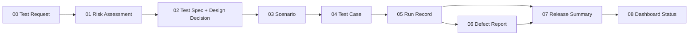

# QA 核心模板：固定版本參考副本

這裡保存九份 QA Decision Desk Markdown 模板的固定版本參考副本，版本為 **v0.3.0**。正式編寫來源由 [RiskQADemoSite 維護](https://github.com/sanyoii/RiskQADemoSite/tree/0a4d1d099651d5bcedb49f85965eeb02bbdb0c98/Templates/QA)，來源 commit：`0a4d1d099651d5bcedb49f85965eeb02bbdb0c98`，同步日期：2026-10-26。Wiki 不另訂規則或維護第二份 canonical authoring library。修改先回正式來源審查，再整組更新本副本及版本／雜湊檢查。套用時複製到實際 release repository，保留當次版本；不能用 transclusion 讓歷史證據隨模板更新。

## Decision flow



## Template index

| Canonical Markdown | English example | 繁體中文示例 | Suggested repository copy |
|---|---|---|---|
| [00 QA Test Request](00-qa-test-request.md) | [English](https://github.com/sanyoii/RiskQADemoSite/blob/0a4d1d099651d5bcedb49f85965eeb02bbdb0c98/public/qa-templates/qa-test-request.en.html) | [繁體中文](https://github.com/sanyoii/RiskQADemoSite/blob/0a4d1d099651d5bcedb49f85965eeb02bbdb0c98/public/qa-templates/qa-test-request.html) | `docs/quality/<release>/quality-decision-brief.md` |
| [01 Quality Risk Assessment](01-quality-risk-assessment.md) | [English](https://github.com/sanyoii/RiskQADemoSite/blob/0a4d1d099651d5bcedb49f85965eeb02bbdb0c98/public/qa-templates/quality-risk-assessment.en.html) | [繁體中文](https://github.com/sanyoii/RiskQADemoSite/blob/0a4d1d099651d5bcedb49f85965eeb02bbdb0c98/public/qa-templates/quality-risk-assessment.html) | `docs/quality/<release>/risk-assessment.md` |
| [02 Test Spec](02-test-spec.md) | [English](https://github.com/sanyoii/RiskQADemoSite/blob/0a4d1d099651d5bcedb49f85965eeb02bbdb0c98/public/qa-templates/test-spec-template.en.html) | [繁體中文](https://github.com/sanyoii/RiskQADemoSite/blob/0a4d1d099651d5bcedb49f85965eeb02bbdb0c98/public/qa-templates/test-spec-template.html) | `docs/quality/<release>/test-spec.md` |
| [03 Test Scenario](03-test-scenario.md) | [English](https://github.com/sanyoii/RiskQADemoSite/blob/0a4d1d099651d5bcedb49f85965eeb02bbdb0c98/public/qa-templates/test-scenario-template.en.html) | [繁體中文](https://github.com/sanyoii/RiskQADemoSite/blob/0a4d1d099651d5bcedb49f85965eeb02bbdb0c98/public/qa-templates/test-scenario-template.html) | `docs/quality/<release>/coverage-inventory.md` |
| [04 Test Case](04-test-case.md) | [English](https://github.com/sanyoii/RiskQADemoSite/blob/0a4d1d099651d5bcedb49f85965eeb02bbdb0c98/public/qa-templates/test-case-template.en.html) | [繁體中文](https://github.com/sanyoii/RiskQADemoSite/blob/0a4d1d099651d5bcedb49f85965eeb02bbdb0c98/public/qa-templates/test-case-template.html) | `docs/quality/<release>/test-cases.md` |
| [05 Test Run Record](05-test-run-record.md) | [English](https://github.com/sanyoii/RiskQADemoSite/blob/0a4d1d099651d5bcedb49f85965eeb02bbdb0c98/public/qa-templates/run-log.en.html) | [繁體中文](https://github.com/sanyoii/RiskQADemoSite/blob/0a4d1d099651d5bcedb49f85965eeb02bbdb0c98/public/qa-templates/run-log.html) | `test-records/<run-id>/run-record.md` |
| [06 Defect Report](06-defect-report.md) | [English](https://github.com/sanyoii/RiskQADemoSite/blob/0a4d1d099651d5bcedb49f85965eeb02bbdb0c98/public/qa-templates/bug-report-template.en.html) | [繁體中文](https://github.com/sanyoii/RiskQADemoSite/blob/0a4d1d099651d5bcedb49f85965eeb02bbdb0c98/public/qa-templates/bug-report-template.html) | `docs/quality/<release>/defect-log.md` |
| [07 Release Quality Summary](07-release-quality-summary.md) | [English](https://github.com/sanyoii/RiskQADemoSite/blob/0a4d1d099651d5bcedb49f85965eeb02bbdb0c98/public/qa-templates/quality-report.en.html) | [繁體中文](https://github.com/sanyoii/RiskQADemoSite/blob/0a4d1d099651d5bcedb49f85965eeb02bbdb0c98/public/qa-templates/quality-report.html) | `docs/quality/<release>/release-quality-summary.md` |
| [08 Dashboard Status Contract](08-dashboard-status-contract.md) | [English](https://github.com/sanyoii/RiskQADemoSite/blob/0a4d1d099651d5bcedb49f85965eeb02bbdb0c98/public/qa-templates/dashboard-status-contract.en.html) | [繁體中文](https://github.com/sanyoii/RiskQADemoSite/blob/0a4d1d099651d5bcedb49f85965eeb02bbdb0c98/public/qa-templates/dashboard-status-contract.html) | `.test-dashboard/status.json` |

九份模板是 library，不代表每次 release 都要建立九份文件。依 `QA-Lite`、`QA-Standard`、`QA-High-Risk` 與 conditional triggers 決定所需組合；Test Run Record 與 Release Quality Summary 每次 release 都不能省略。

Test Design Decision 直接放在 02 Test Spec，**不新增第十個核心模板**。它保存這條可審查鏈：

```text
Risk → Failure mode → Method → Oracle → Execution evidence → Decision
```

選擇 Method 時同時考慮 risk、規格特徵與 observability／environment constraint。Expected result 優先引用 approved requirement、business rule、API／schema contract 或 reviewed domain decision；只有 current behavior 時標為 characterization evidence，無核准來源時誠實標 `Assumption`，來源衝突或需求未定義時標 `Unknown／needs-clarification`。

## Playbook advisory layer

### 填好之後怎麼驗證

QA-Lite 只維護三份 release-specific 記錄：**brief/design、run ledger、decision**。Requirement、Risk、Design、Case 使用穩定 ID；machine packet 引用這三份，不新增另一套審批真相。

以下命令在 RiskQADemoSite／已接入的 release repository 執行，Wiki 本身沒有 runner。依 [執行契約](https://github.com/sanyoii/RiskQADemoSite/blob/0a4d1d099651d5bcedb49f85965eeb02bbdb0c98/docs/decision-workflow.md) 填入 `release-evidence.json`，執行 `npm run review:release -- <packet> --design-only` 檢查設計；實際測試 artifact 與人工 review 齊全後，才執行不含 `--design-only` 的 review 和 `npm run gate:release`。Template heading test 只驗模板，不能代替 filled-packet review。

未解決的必要 oracle、缺少 required case、過期 live/manual run、artifact 雜湊不符與已改變的審查 input 都不得變成 Ready。後續 Pass 追加到台帳；使用 `--previous` 核對不能被刪改的先前 attempts/events。

[`Playbooks/QA`](https://github.com/sanyoii/RiskQADemoSite/blob/0a4d1d099651d5bcedb49f85965eeb02bbdb0c98/Playbooks/QA/README.md) 提供 requirement readiness、coverage analysis、regression selection、test data、API coverage、defect triage 與 RCA 的 reviewable workflow。Playbook 不是第十個核心模板，也不是 evidence source；reviewed findings 仍要落回上表的 release-specific artifacts。

Coverage Analysis 沿用 03 Test Scenario contract，把完整 Requirement／AC → Scenario → Case → Run matrix 寫到 `docs/quality/<release>/coverage-inventory.md`。07 Release Quality Summary 只保留 target vs actual、重要 gaps、residual risk 與 inventory link，不複製完整矩陣。

## Shared rules

- 所有 evidence 都要綁定 repository、release、branch、full SHA、environment、scope、owner 與 timestamps。
- `Fail`、`Blocked`、retry 與後續 `Pass` 全部保留，不能覆寫 chronology。
- Product Test Status 和 Data Status 分開判定。
- `Ready` 需要 human-owned release assessment；測試全綠不會自動產生 Ready。
- 公開前執行 allowlist projection、secret／PII scan、link review 與 post-publish smoke。


## 中英文 HTML 範本與合成示例

以下連結固定到來源 commit 的 HTML 原始檔，可下載後閱讀與列印；不將尚未讀回的線上部署版本當成已核對版本。

[繁體中文入口](https://github.com/sanyoii/RiskQADemoSite/blob/0a4d1d099651d5bcedb49f85965eeb02bbdb0c98/public/qa-templates/index.html)／[English entry](https://github.com/sanyoii/RiskQADemoSite/blob/0a4d1d099651d5bcedb49f85965eeb02bbdb0c98/public/qa-templates/index.en.html)。每種語言都是入口加九份文件，共 20 頁；00～08 與上表一一對應，每份都有空白欄位、Order Book 合成示例及對應語言連結。網站導覽依目前語言開啟閱讀版；Pages 路徑保留 `/test-status/qa-templates/`。檔案可獨立閱讀與列印，沒有編輯、儲存、實測證據或核准功能。

The HTML library provides a complete English and Traditional Chinese reading version of all nine documents, with blank fields and the same synthetic Order Book example. The upstream RiskQADemoSite Markdown remains canonical for authoring; this Wiki copy is version-pinned reference material. Applied release records retain their versions; HTML is not another ledger or approval system. QA-Lite retains brief/design, run ledger and decision as three records.

空白範本與方法源自測試公司 2026-10-25 的範本；v1.2 改用本站 Order Book，v1.3 補齊申請、風險、公開狀態契約與完整雙語內容。原公司檔案及歷史 Run 不改寫。九份 Markdown v0.3.0 保留版本與資料契約、readiness／授權、三項退出條件、四面向摘要及分歧／AI 誤判恢復；適用欄位填寫，不適用寫原因。維護方式見 [產生器說明](https://github.com/sanyoii/RiskQADemoSite/blob/0a4d1d099651d5bcedb49f85965eeb02bbdb0c98/Templates/QA/samples/README.md)。

## Wiki 接手與檢查

- [[wiki/一人軟體測試公司/_index|正式測試公司 Wiki 入口]]
- 案件狀態仍以正式公司的 `專案/<id>/case.json` 為準；不將範例或舊 Wiki 狀態升為現況。
- `py -3 -B -X utf8 -m unittest discover -s scripts -p test_qa_template_mirror.py` 核對九份檔案、版本、固定來源雜湊與入口連結。這是副本完整性檢查，不是實際 release 驗收。

本批差異及未合併項目：[[output/2026-10-26-main-integration-batch2|第二批接手紀錄]]。
