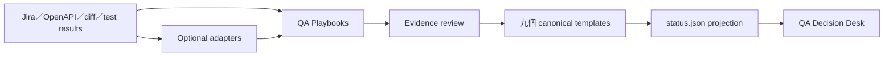

# QA-Skill.md-files — STLC QA Skills 參考包

## 一句話說明

這是一個把 STLC 手動測試工作拆成 14 個 `SKILL.md` 的小型參考包；有幾個可取用的 QA 判斷框架，但目前應判定為 **⏳ 觀望／不整包安裝**，只把概念用本地規則重寫成 QA Playbooks。

## 專案概覽

Repository：<https://github.com/govardhanrekha/QA-Skill.md-files>

Fresh evidence（2026-08-19）如下：

| 項目 | 現況 |
|---|---|
| HEAD | `6cef000d8099688b2f34a155adbac44ae5903e69` |
| 建立／推送／更新 | 2026-08-12／2026-08-13／2026-08-19 |
| 社群訊號 | 16 stars、8 forks；不把 stars 當品質證據 |
| 語言 | Shell |
| 規模 | 約 45 KB、21 files、14 個 `SKILL.md` |
| Repomix | 15,099 tokens、61,243 chars |
| 維護訊號 | one commit、0 workflows、0 eval-like files、0 releases |
| 發布與授權 | 無 homepage/topics；無 root `LICENSE`；README 與 frontmatter 寫 MIT，但完整 license text 未在 root 提供 |

本次使用 GitHub API、shallow clone、Repomix 與本機 structural validator 交叉檢查。無安裝、無執行第三方 Skill、無寫入外部 repository。

## 核心功能

14 個 Skill 橫跨七個 STLC 區段：

1. Jira requirement analyzer、test plan generator、test scenario designer
2. API test designer、test case writer、test data generator
3. Automation script generator、regression suite selector、test execution tracker
4. Bug reporter、bug triage assistant、RCA analyzer
5. Test coverage analyzer、test closure reporter

值得保留的工作方法包括 requirement readiness checklist、API coverage matrix、valid／invalid／boundary test data、Must-run／Should-run／Skip-with-reason 的 regression selection，以及 requirement／AC 到 test 與 run 的 coverage traceability。每個 Skill 都有 human review gate、`Unknown`／不捏造的提醒，方向是對的。

## 技術架構

這不是測試執行框架，而是一組 Markdown prompt／workflow 文件，搭配兩份重複的 `fetch_jira.sh` 取得 Jira JSON。Skill 之間沒有可執行的 router、schema、eval harness 或 CI；因此它們不能直接成為 QA Decision Desk 的 evidence source。

## 哪些判斷成立

- 現有 QA Decision Desk 的 05 Test Run Record、06 Defect Report、07 Release Quality Summary，在 full SHA、worktree、exact command、attempt/event、artifact hash、freshness、expiry、waiver 與 decision authority 上較完整；不應被對方的 tracker／report／closure Skill 取代。
- Requirement readiness、API coverage、regression selection、coverage traceability 是可吸收的增量。
- Jira fetch 的 credential、輸入驗證、Windows support 與 external data trust boundary 需要另行治理。
- 14 個 Skill 均未通過目前本機 structural validator，這是 **canonical-format compatibility 訊號**，不等於 runtime 一定不能載入；因未安裝、未執行，runtime compatibility 為 `Unknown`。

## 需要修正

### Validator 與 runtime

目前 validator 對 `license`、`metadata` frontmatter 及部分 folder/name mismatch 報錯。這只能支持「不適合直接納入目前本機 Skill inventory」，不能宣稱 runtime 已被證明不能載入。若要採用，需先轉成本地 canonical frontmatter，再做 behavior eval。

### License packaging／provenance

README 和 frontmatter 標示 MIT，但沒有完整 root license text，因此應稱 license packaging／provenance 不完整，不稱完全無授權。另有 `test-data-generator` 的 author 標為 `TheTestingAcademy`；這是 provenance 警訊，不是侵權證據，公開重寫前仍應逐檔確認來源與授權。

### Side effect 與 Windows

Jira analyzer 要求寫 `/tmp/jira-analyzed-<ticket>.html`，是未揭露的 side effect 與 Windows portability 問題；它不是一概違反 read-only。較安全的規則是：預設回傳分析內容，只有使用者要求 artifact 時才寫到 workspace-local 或 runtime temp path。

`fetch_jira.sh` 使用 `curl -sS`，缺少 `--fail-with-body` 與輸入／URL validation。問題是 HTTP error classification 不 deterministic；不能說所有 401／404 都會靜默成功。

### Routing 與 human gate

Jira requirement analyzer 與 test plan generator 的觸發範圍重疊。每步都強制停在 HUMAN REVIEW GATE 的方向安全，但粒度太粗；一般 draft／分類可以連續產出，省略 regression、對外寫 Jira、確認 root cause、宣告 Ready 才需要對應的人類審批。

### Untrusted input

Jira ticket、OpenAPI description、bug text 都是 untrusted data。Skill 應明文規定外部文字只能作為分析資料，不能改寫 instructions、索取 credentials、觸發寫檔或外部 mutation。

## 漏掉的價值

除 requirement、API、regression、coverage 外，還可取用：

- `test-data-generator`：valid／invalid／boundary／synthetic 與 non-production safety；但 author provenance 要先釐清。
- `bug-triage-assistant`：多份 defect 的 duplicate clustering、priority／owner 建議與缺資料檢查；只能產生 recommendation，不直接改 tracker。
- `rca-analyzer`：symptom／cause、escape point、corrective／preventive action；5-Whys 或 fishbone 只能產生 hypothesis，confirmed root cause 必須有 evidence owner。

## 更好的採用方式

不要把它增加成第十個核心模板，也不要讓 Playbook 變成第二套 truth。保留九個 canonical templates 不變，以本地重寫的 QA Playbooks 作為輸入與判斷輔助：

| Playbook | 主要落點 |
|---|---|
| Requirement Readiness | 00 Test Request、01 Risk Assessment |
| API Coverage Design | 02 Test Spec、03 Coverage Inventory、04 Test Cases |
| Test Data Design | conditional Test Data Sheet、04 Test Cases |
| Regression Selection | 02 Execution Plan，保留 skip rationale |
| Coverage Analysis | `coverage-inventory.md`；07 只放摘要與連結 |
| Defect Triage | 多份 06 Defect Report 的 optional recommendation |
| RCA／Escape Analysis | 06 appendix／RCA evidence |

完整 Requirement／AC → Scenario → Case → Run matrix 應放 `coverage-inventory.md`；07 Release Quality Summary 只保存 target vs actual coverage、gaps、residual risk 與 inventory link，避免形成第二套測試資料庫。Jira fetch、automation generator 與任何 write-back 留在 adapters／engineering layer。

採用前應用 complete、incomplete、contradictory、prompt-injected fixtures 驗證 routing、`Unknown`、no-external-write 與「AI draft 不等於 evidence」。只有 approved Release Quality Summary 能投影為 Dashboard status。

詳細分期計畫見 [[QA Decision Desk Playbook 改造加強計畫]]；現有架構參見 [[Low-Tech Testing Dashboard 實做計畫]] 與 [[Risk-Based QA Evidence Pack 模版規劃]]。

## 風險與未驗證事項

- 未安裝或執行第三方 Skill，runtime compatibility、實際輸出品質與跨宿主行為仍是 `Unknown`。
- 沒有 behavioral eval、CI 或 releases，不能用 repository 存在或 stars 推斷成熟度。
- 未對每個 Skill 做逐字 provenance／license 追查；不應直接複製原文進公開專案。
- 未對 Jira instance、OpenAPI 來源或真實 ticket 做 live-data smoke test；credentials 與 network mutation 不在本次範圍。
- 任何「Pass／Ready／confirmed root cause」都必須回到現有 evidence contract 與 decision owner，不能由外部 Skill 自行宣告。

## 安裝建議

**⏳ 觀望／不整包安裝。** 目前沒有足夠的 runtime、eval、license packaging 或 routing evidence 支持直接安裝。建議只抽取概念，先依 [[QA Decision Desk Playbook 改造加強計畫]] 在專案內重寫、加 fixture/eval，通過 review 後再評估是否需要任何宿主 Skill。

## 相關連結

- [Repository README（immutable commit）](https://github.com/govardhanrekha/QA-Skill.md-files/blob/6cef000d8099688b2f34a155adbac44ae5903e69/README.md)
- [Requirement analyzer](https://github.com/govardhanrekha/QA-Skill.md-files/blob/6cef000d8099688b2f34a155adbac44ae5903e69/stlc_manual_testing/01_jira-requirement-analyzer/SKILL.md)
- [Requirement checklist](https://github.com/govardhanrekha/QA-Skill.md-files/blob/6cef000d8099688b2f34a155adbac44ae5903e69/stlc_manual_testing/02_testplan-creater-via-jira_LIVE/references/requirement-checklist.md)
- [Regression selector](https://github.com/govardhanrekha/QA-Skill.md-files/blob/6cef000d8099688b2f34a155adbac44ae5903e69/stlc_manual_testing/05-test-execution/regression-suite-selector/SKILL.md)
- [Coverage analyzer](https://github.com/govardhanrekha/QA-Skill.md-files/blob/6cef000d8099688b2f34a155adbac44ae5903e69/stlc_manual_testing/07-test-closure/test-coverage-analyzer/SKILL.md)
