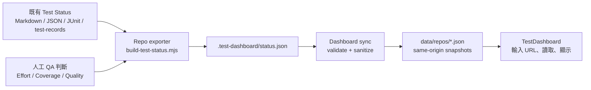

# Low-Tech Testing Dashboard 實做計畫

**Status: Prototype Plan**

目前 `C:\Users\sanyo\OneDrive\文件\ChatGPT\TestDashboard` 是空的 Git repository。本頁維持 **planning／prototype** 狀態，不代表 Dashboard 已經完成，也不代表任何來源 repository 已接入。本次只修訂計畫：未建立模板或程式、未執行產品測試、未發布 Dashboard。

> [!important] Evidence Contract 前置條件
> Dashboard schema freeze 與來源 repo onboarding 前，先依 [[Risk-Based QA Evidence Pack 模版規劃]] 完成一個 repo、一次 release 的 Quality Decision Contract vertical slice。九種模板是 library，不是固定九份文件；`.test-dashboard/status.json` 必須由 current evidence 與 human-owned Release Quality Summary 衍生。該頁另定義原子發布、防竄改、公開分層、撤回／退役與 pilot 停損條件。

## 決策摘要

採用「**人工判斷為主、機器讀取為輔**」的 static dashboard：

1. 使用者在 Dashboard 輸入各個 GitHub repository URL。
2. 每個來源 repository 以固定路徑 `.test-dashboard/status.json` 發布標準狀態；同步程式將核准公開的欄位複製成 Dashboard 的 same-origin sanitized snapshot。
3. 首頁顯示各 repository 的整體 Test Status 與資料健康狀態。
4. 點入 repository 後，以五欄表格呈現 Product Area、Test Effort、Coverage、Quality、Comments。
5. CI、測試結果、issue 與 test records 只作為 evidence；不得自動把通過率換算成品質綠燈。

單靠 repository URL 無法可靠推導 Test Status。每個來源 repository 都必須提供一份由 QA 負責、可追溯證據的標準狀態檔；如果現有測試狀態不是這個格式，就新增 exporter 將既有資料轉成 Dashboard contract。公開 Dashboard 不在瀏覽器保存 GitHub token，也不直接公開 private repository 的 raw status、logs 或 artifacts。



## 問題與成功條件

### 要解決的問題

管理者問的通常是「測完了嗎、能出貨嗎」，但真實測試狀態不是單一 Pass/Fail。Dashboard 必須把測試深度、資源投入、品質風險與阻礙壓縮成一眼可理解的畫面，同時保留每個判斷的理由與證據。

### 成功條件

- 貼上一個已設定的 public GitHub repository URL 後，可以看到目前 Test Status。
- 多個 repository 可在同一頁比較，但單一 repository 失敗不影響其他項目。
- 管理者能快速區分 Ready、At Risk、Blocked、Unknown。
- 黃色、紅色、`executionState=paused/blocked` 都有可見原因。
- Dashboard 能指出資料過期、格式錯誤或尚未設定，但不把資料問題誤報成產品品質問題。
- 每個狀態都能追溯到 commit SHA、測試紀錄、issue 或 artifact。
- 後續 PASS 不會覆蓋或隱藏先前 Fail／Blocked chronology。

## 2026-08-15 Repository 與 Hosting 稽核

### 直接結論

「增加 `.test-dashboard/config.json`、`status.json` 與 exporter」是共同必要基礎，但不是所有 repository 都只加這三項就完成：

- **CEX lab、Web3 portfolio**：最接近可接入；已有 JUnit／test plan，但仍要補五欄人工狀態、freshness 與 current SHA。
- **WorkFlowStudio、TaskDashboard、Skill_Rewrite、JobSmith**：需要 exporter 統一既有結果，且仍要人工補 Product Area、Effort、Coverage、Quality、Comments。
- **Knowing Codex**：不同 canary／eval 同時存在 PASS、FAIL、DEGRADED、BLOCKED；必須先定義 aggregate scope，不能直接壓成單一顏色。

本輪只做 read-only inventory，沒有執行任何測試。下表中的 PASS 都是既有 receipt，不是 2026-08-15 本輪 fresh proof。

### 候選 Repository Matrix

| 優先 | Repository | 已驗證測試／證據 | Current proof 狀態 | 接入判定 |
|---:|---|---|---|---|
| 1 | `D:\Codex\Web3\cex-market-data-quality-lab` — `sanyoii/cex-market-data-quality-lab` `main@8fd5081254b5429e480ec20a56ef09bcc6f5ab9e` | pytest，6 個 test files；JUnit；deterministic／live receipts | Worktree dirty；public HEAD 與 local candidate 結果不同；manual `MTC-*` 未執行 | **有條件適合作 Pilot 0 candidate**；named target 已核准為 `0.1.0 @ 8fd5081254b5429e480ec20a56ef09bcc6f5ab9e`；required live＋兩個 manual cases 尚缺 current evidence，dirty candidate／local old PASS 只能列 historical/local evidence |
| 2 | `D:\Codex\Web3` — `sanyoii/sanyoii.github.io` `main@b18c9b9` | pytest + Playwright；17 cases；JUnit 與 `TESTPLAN.md` | Receipt 早於目前 HEAD，且 worktree dirty；應標 Stale／Unknown | **可能的後續 adapter candidate**；Pilot 0 通過前不得 onboarding，且需 fresh run 與五欄人工 mapping |
| 3 | `D:\Codex\WorkFlowStudio` — `sanyoii/agent-workflow-studio` `main@717ffac` | Vitest 40 個 core tests；Electron/live E2E；custom JSON／screenshots | 最新 renderer receipt 晚於部分資料但早於 HEAD；無 current aggregate | **Needs exporter**；保留舊 Fail／Blocked chronology |
| 4 | `D:\Codex\TaskDashboard` — `sanyoii/TaskDashboard` `main@54d3f4f` | Node test runner；3 個 unit test files + 1 browser E2E | 無本機 result artifact；release checklist 仍有未完成 gates | **Needs exporter**；private repo 不由公開 browser 直接讀取 |
| 5 | `D:\Codex\Skill_Rewrite` — `codex/skills-dashboard-refresh@9991c62` | Node test runner；2 個 test files；human receipt | `npm test` 未涵蓋第二支 test file；receipt 無 repo SHA；worktree dirty | **Needs exporter**；先修正完整 test command 與 SHA traceability |
| 6 | `D:\Codex\[Job Tool] JobSmith` — `sanyoii/jobsmith` `master@4340e9c` | pytest；35 個 `tests/test_*.py`；default 與 live markers | 無 JUnit、coverage、test-record、CI result；測試檔有修改 | **Needs exporter**；current status 為 Unknown |
| 7 | `D:\Codex\Knowing Codex` — `sanyoii/KnowingCodex` `main@c0a2591` | PowerShell test／validate scripts；JSON eval definitions 與 receipts | 多種互斥 verdict，沒有單一 current repo verdict | **Needs manual status**；先定義 scope 與 aggregate policy |

所有候選 repository 均缺 `.test-dashboard/config.json`、`status.json`、repo-local exporter，以及 normalized 五欄 contract；目前結構覆蓋為 **0/5**。Generated fixtures、publication candidates 與空的 TestDashboard checkout 不列為來源 repository。

### GitHub Pages Hosting 決策

已驗證現況：

- `https://sanyoii.github.io/` 來源是 public repository `sanyoii/sanyoii.github.io`。
- Pages 狀態為 `built`，使用 legacy branch deployment：`main:/`。
- Root 是正式雙語 portfolio；單一手寫 `index.html`、無 framework、無 build step、無 custom domain、HTTPS enforced。
- 現行 Tests workflow 與 Pages deployment 平行；歷史上 Tests failure 時 Pages 仍可部署，因此不能宣稱「測試通過才上線」。
- `C:\Users\sanyo\OneDrive\文件\ChatGPT\TestDashboard` 目前是 unborn `main`，沒有 commit、remote、Dashboard source、tests 或 build artifact；另有未追蹤 `council/` continuity sources，不得視為產品實作或清理目標。

採用：

- 建立獨立 public repository `sanyoii/test-status`。
- 使用目前 `TestDashboard` checkout 作為 source workspace。
- 發布 URL：`https://sanyoii.github.io/test-status/`。
- 使用 gated GitHub Actions Pages workflow：deploy job 必須 `needs` validation／test job。
- 所有 asset 使用 `./assets/...`；不用 root-relative `/assets/...`，不用 history routing。

不採用：

- 不取代 `sanyoii.github.io` root `index.html`。
- 不把 Dashboard lifecycle 混入目前 dirty 的 `D:\Codex\Web3` worktree。
- 不重用 private `TaskDashboard`；用途、visibility 與 stack 不同。
- 不在 public frontend 放 GitHub PAT、private repo token、raw logs 或 private test records。

建立 GitHub repository、設定 public visibility、啟用 Pages、push 與 production deployment 都是外部 mutation，必須另行取得明確授權；本計畫不代表已授權執行。

## Low-Tech 設計原則

### 一眼可讀

- 每個 repository 建議維持 15–30 個 Product Areas。
- Product Area 使用使用者或管理者理解的名稱，例如「登入／帳號管理」，不用內部 class、package 或 database 名稱。
- Detail view 嚴格保留五個主要欄位，不增加密集的工程指標。
- 會議時應直接投影 Dashboard，不把連結當作附件丟給管理者自行尋找。

### 人對品質判斷負責

- 自動化可以提供執行結果、時間、SHA、log 與 artifact。
- Test Effort、Coverage、Quality、Release Assessment 由 QA 明確判斷。
- Dashboard 可以指出資料矛盾，但不能偷偷修改 QA 的 assessment。
- 綠色代表可以被辯護的承諾，不代表「自動化測試通過率很高」。

### 風險導向，而非全部 Level 3

1. 先讓所有區域脫離 Level 0，至少完成 Level 1 sanity check。
2. 核心使用者流程推進到 Level 2。
3. 只對高衝擊、高複雜度、安裝、安全或可靠性區域進行 Level 3。
4. 不同 Product Area 可以有不同 target coverage，但 target 必須事先定義。

## MVP 範圍

### 第一版包含

- GitHub public repositories。
- 新增、移除、重新整理 repository URL。
- 使用瀏覽器 `localStorage` 保存 repository 清單。
- 從 `data/repos/index.json` 將 repository URL 對應到 same-origin sanitized snapshot。
- 由 `scripts/sync-status.mjs` 在發布前讀取、驗證並消毒來源 `.test-dashboard/status.json`。
- Portfolio Overview 與 Repository Detail。
- Schema validation、stale detection、conflict detection。
- Loading、empty、missing、invalid、unreachable、partial failure 狀態。
- 桌面、手機與會議投影可讀。
- Static hosting；不需要 backend、database、登入或 token。

### 第一版不包含

- Private repository authentication。
- Browser-side GitHub token 或 runtime authenticated fetch。
- 尚未進入 sanitized registry 的 private repository status。
- GitLab、Bitbucket 或其他 Git provider。
- Dashboard 直接寫回 repository。
- 自動 commit 或自動建立 issue。
- Jira／GitHub Issues 雙向同步。
- 自動從 test pass rate 推導 Coverage、Quality 或 Ship 決策。
- 趨勢圖、velocity、bug 數量排行榜或複雜下鑽分析。

## 每個來源 Repository 要增加的內容

建議結構：

```text
your-repo/
├─ .test-dashboard/
│  ├─ config.json
│  └─ status.json
├─ scripts/
│  └─ build-test-status.mjs
└─ test-records/
   └─ ...
```

### `.test-dashboard/config.json`

保存不常變動的 Product Area 定義與政策：

```json
{
  "schemaVersion": 1,
  "projectName": "Project Alpha",
  "statusSource": "test-records/latest.json",
  "staleAfterHours": 72,
  "areas": [
    {
      "id": "authentication",
      "name": "登入／帳號管理",
      "targetCoverage": "2",
      "critical": true
    },
    {
      "id": "reporting",
      "name": "報表檢視",
      "targetCoverage": "1",
      "critical": false
    }
  ]
}
```

用途：

- 把技術模組或 test suite 名稱映射成業務可理解的 Product Area。
- 定義核心區域與最低 Coverage。
- 定義資料多久沒有更新後應標示 Stale。
- 避免在每次狀態更新時重複輸入固定資訊。

### `.test-dashboard/status.json`

這是 Dashboard 預計讀取的公開契約。**下列內容只是 D1 freeze 前的 illustrative candidate，不是已核准 schema，也不是 current product evidence**；required fields、version 與 enum 仍須由 canonical Evidence Contract 核准後才能實作。

```json
{
  "schemaVersion": 1,
  "contractStatus": "illustrative-unapproved",
  "repository": "owner/project-alpha",
  "branch": "main",
  "environment": "windows-11; python-3.12; public-ci",
  "testedScope": ["REST contract", "order book sync"],
  "excludedScope": ["live exchange compatibility"],
  "confidentiality": "public-candidate",
  "release": {
    "target": "v1.4.0",
    "releaseAssessment": "at-risk",
    "summary": "核心流程可用，安裝流程仍受阻",
    "decidedAt": "2026-08-15T21:30:00+08:00",
    "expiresAt": "2026-08-18T21:30:00+08:00",
    "decisionOwnerRef": "authority.decisionOwner",
    "commitSha": "abc1234abc1234abc1234abc1234abc1234abc1"
  },
  "authority": {
    "qaOwner": "QA Owner",
    "reviewer": "QA Reviewer",
    "decisionOwner": "Release Owner",
    "publisher": "Dashboard Publisher"
  },
  "runs": [
    {
      "runId": "RUN-20260816-001",
      "executedAt": "2026-08-15T20:40:00+08:00",
      "evidencePath": "test-records/2026-08-15-regression.md",
      "artifactHash": "sha256:illustrative-only"
    }
  ],
  "provenance": {
    "generatedFrom": ["RUN-20260816-001", "RQD-V140-001"],
    "protectedSource": "human-review-required",
    "generatedAt": "2026-08-15T21:31:00+08:00",
    "syncedAt": "2026-08-15T21:32:00+08:00"
  },
  "areas": [
    {
      "id": "authentication",
      "name": "登入／帳號管理",
      "effortLevel": "high",
      "executionState": "blocked",
      "coverage": "2",
      "targetCoverage": "2",
      "quality": "warning",
      "comment": "AUTH-142；OAuth 尚未完成回歸",
      "evidence": [
        {
          "label": "Regression test record",
          "path": "test-records/2026-08-15-regression.md",
          "status": "blocked"
        }
      ]
    }
  ]
}
```

### 欄位規則

| 欄位 | 允許值或要求 |
|---|---|
| `release.releaseAssessment` | `ready`、`at-risk`、`blocked`、`unknown`；human-owned，不由 pass rate 推導 |
| `release.decisionOwnerRef` | 固定為 `authority.decisionOwner`；canonical 值只存在 `authority.decisionOwner`，不得形成第二個權威欄位 |
| `branch`／`release.commitSha` | branch 與 full SHA 必填；必須符合 approved subject |
| `environment` | OS、runtime、browser/device、external dependency class；不可只寫 `local` |
| `testedScope`／`excludedScope` | 皆為明確清單；空白 excluded scope 不等於全部已測 |
| `effortLevel` | `none`、`low`、`medium`、`high`；只描述投入程度 |
| `executionState` | `not-started`、`in-progress`、`paused`、`blocked`、`complete`；只描述執行進度 |
| `coverage` | `0`、`1`、`1+`、`2`、`2+`、`3` |
| `quality` | `good`、`warning`、`bad` |
| `comment` | `warning`、`bad` 或 `executionState=paused/blocked` 時必填 |
| `decidedAt`／`expiresAt` | ISO 8601 日期時間，必填；過期後降為 Stale／Unknown |
| `authority.qaOwner`／`reviewer`／`decisionOwner`／`publisher` | 分別記錄判斷、覆核、決策與公開責任；兼任要揭露 |
| `runs`／`provenance` | 至少一個 run ID、執行時間、evidence、artifact hash/缺失理由、generated-from、protected source |
| `provenance.generatedAt`／`provenance.syncedAt` | 分開記錄產生與同步時間；不得拿 `updatedAt` 代替 run time |
| `confidentiality` | `internal`、`restricted`、`public-candidate`、`public`；公開 projection 只接受核准值 |
| `evidence` | 指向 test record、issue 或 artifact；不得含 secret 或個資 |

`Ship` 不得出現在 `effortLevel`、`executionState` 或任何 effort 欄位；出貨判斷只存在 `releaseAssessment`。舊單一 `effort` schema 與含 `ship` 的 fixture／範例一律視為 migration input，不得作正式實作路徑。

### `scripts/build-test-status.mjs`

只有現有 Test Status 不能直接符合 contract 時才需要 exporter。責任包括：

1. 讀取現有 Markdown、JUnit XML、JSON 或其他測試紀錄。
2. 擷取 commit SHA、執行時間、Pass／Fail／Blocked／Skipped。
3. 依 `config.json` 映射 Product Areas。
4. 合併人工維護的 Effort、Coverage、Quality 與 Release Assessment。
5. 驗證資料後輸出 `status.json`。

Exporter 不得：

- 根據「90% tests passed」自動把 Quality 設為 Good。
- 把沒有資料的區域假設成 Pass 或 Good。
- 因新一輪 PASS 而刪除先前 Fail／Blocked 紀錄。
- 自動 commit、push 或改寫 production repository。

如果來源 repository 現有狀態已經是符合 schema 的 JSON，可以省略 exporter。

## TestDashboard 要增加的程式

建議採用 Vanilla HTML、CSS、JavaScript static app，第一版不引入 framework、backend 或 production authentication。

```text
TestDashboard/
├─ .github/
│  └─ workflows/
│     └─ pages.yml
├─ .nojekyll
├─ index.html
├─ styles.css
├─ src/
│  ├─ main.js
│  ├─ repo-url.js
│  ├─ data-source.js
│  ├─ status-validator.js
│  ├─ status-policy.js
│  ├─ repo-registry.js
│  └─ render-dashboard.js
├─ data/
│  └─ repos/
│     ├─ index.json
│     └─ <owner>--<repo>.json
├─ scripts/
│  ├─ sync-status.mjs
│  └─ validate-status.mjs
├─ schema/
│  └─ test-status.schema.json
├─ fixtures/
│  ├─ valid-status.json
│  └─ invalid-status.json
├─ tests/
│  ├─ repo-url.test.mjs
│  ├─ data-source.test.mjs
│  ├─ status-validator.test.mjs
│  ├─ status-policy.test.mjs
│  └─ dashboard.e2e.spec.mjs
├─ package.json
└─ README.md
```

### 程式責任

| 程式 | 責任 |
|---|---|
| `repo-url.js` | 驗證並解析 `https://github.com/{owner}/{repo}`；移除 `.git`、query、fragment |
| `data-source.js` | 從 same-origin registry 將 normalized repository URL 對應到 sanitized snapshot |
| `status-validator.js` | 驗證 schema、required fields、enum、日期與 comment 規則 |
| `status-policy.js` | 檢查 Ready/Blocked 衝突、Coverage target 與資料過期 |
| `repo-registry.js` | 使用 `localStorage` 保存輸入的 repository 清單 |
| `render-dashboard.js` | 顯示 overview、五欄 detail、legend、資料狀態與錯誤 |
| `main.js` | 串接新增、移除、refresh、loading 與 rendering 流程 |
| `sync-status.mjs` | 讀取來源 contract，驗證、移除未核准欄位、輸出 public same-origin snapshot |
| `validate-status.mjs` | 在部署前驗證 registry、snapshot、schema、URL、freshness 與敏感資料規則 |
| `pages.yml` | 先 validation／tests，再部署同一 SHA 的 static artifact 到 GitHub Pages |

## Repository URL 讀取流程

```text
輸入 URL
→ 僅接受 https://github.com/{owner}/{repo}
→ 正規化並移除 .git、query、fragment
→ 在 data/repos/index.json 查找 normalized URL
→ 讀取 same-origin sanitized snapshot
→ 驗證 schema
→ 執行 policy checks
→ 儲存 repository registry
→ 顯示 overview 與 detail
```

錯誤必須精確區分：

- Invalid URL
- Repository not found
- Repository not published／Not Configured
- Snapshot missing
- Invalid status schema
- Snapshot unavailable
- Stale status
- Status conflict

不得把讀取失敗顯示成品質紅燈；資料未知不等於產品品質差。

## Dashboard 資訊架構

### Portfolio Overview

每個 repository 顯示一張狀態卡：

- Repository 名稱與 GitHub 連結。
- 人工發布的 Release Assessment。
- Product Areas 的 Good、Warning、Bad、Unknown 數量。
- Blocked areas 數量。
- 最低 Coverage 與未達 target 數量。
- Target release／build。
- Last updated、assessor、commit SHA。
- `Fresh / Stale / Invalid / Not Configured / Unreachable` 資料狀態。

### Repository Detail

主要畫面只保留五欄：

| Product Area | Test Effort | Coverage | Quality | Comments |
|---|---|---|---|---|
| 登入／帳號 | High | Level 2 | Warning | AUTH-142；OAuth 尚未回歸 |
| 安裝／部署 | Blocked | Level 1 | Bad | Staging build 無法啟動 |
| 報表檢視 | High／Complete | Level 2+ | Good | 核心案例完成；release decision 另見 Assessment |

五欄畫面可將投入與進度合併顯示為 `High／Complete`，但來源 contract 必須分別保存 `effortLevel=high` 與 `executionState=complete`；不得在 display 或 schema 中用 `Ship` 代替 release decision。

顏色之外必須同時顯示文字、icon 與固定可見的 legend，避免色覺障礙，也避免不同人對黃色或紅色有不同解讀。

### 投影模式

- 放大字體與狀態標籤。
- 隱藏新增、移除等次要控制項。
- 保留更新时间、commit SHA、紅黃原因與 legend。
- 不加入需要點擊才能看到核心風險的深層選單。

## 必須分開的兩種狀態

### Product Test Status

由 QA 判斷：

- Ready
- At Risk
- Blocked
- Unknown

### Dashboard Data Status

由程式判斷：

- Fresh
- Stale
- Invalid
- Not Configured
- Unreachable

例如 GitHub API 讀取失敗應顯示 `Unreachable`，不能顯示產品品質 `Bad`。

## Status Policy

Dashboard 不修改 QA assessment，只提示矛盾：

| 狀況 | Dashboard 行為 |
|---|---|
| `releaseAssessment=ready` 但存在 `bad` | 顯示 `Status conflict`，公開 projection 降為 Unknown |
| `releaseAssessment=ready` 但 `executionState=blocked` | 顯示 `Status conflict`，公開 projection 降為 Unknown |
| Ready 但 critical area 未達 Coverage target | 判定 `COVERAGE_TARGET_NOT_MET` policy failure；public projection 降為 Product Status `Unknown` |
| `warning`、`bad` 或 `executionState=paused/blocked` 沒有 comment | 判定資料 Invalid |
| 超過 `staleAfterHours` | 保留 last-known decision 作 chronology，但 current projection 顯示 Data Status `Stale`、Product Status `Unknown` |
| 找不到 `status.json` | 顯示 Not Configured |
| Schema 不合法 | 顯示 Invalid，不猜測 Test Status |
| 部分 repository 失敗 | 其他 repository 繼續正常顯示 |

## 更新流程與責任

### QA Owner

- 依核准 Freshness SLA 更新：Pilot 0 deterministic evidence 以 SHA 改變或 30 calendar days 先到者為準；live evidence 7 calendar days；release assessment 自 `decidedAt` 起 7 calendar days。不得用新 run 延長不同 SHA／scope 的舊證據。
- Retention：JUnit／raw artifacts 保留 90 calendar days；sanitized receipts、release decisions、withdrawal／superseded chronology 保留至 project retirement 後 1 年。到期後保留 metadata／hash／unavailable reason；刪除仍需 scoped approval。
- Pilot public projection allowlist：repository、branch、full SHA、release target、assessment、coverage、test counts、timestamps、public Actions links、sanitized limitations。Deny local absolute paths、raw response/log、secret、account/trade data、internal URL、computer username、unsanitized defect detail；命中即 fail closed。
- 對每一個 `effortLevel`、`executionState`、Coverage、Quality、`releaseAssessment` 負責。
- 為 Warning、Bad、`executionState=paused/blocked` 提供理由。
- 確認 `commitSha` 與 evidence 對應同一測試版本。

### Repository Maintainer

- 保存 `.test-dashboard/` contract。
- 確保 evidence path 可存取且不含秘密資訊。
- 如果使用 exporter，維護輸入格式轉換與 validation。

### Dashboard

- 只讀取資料，不回寫來源 repository。
- 呈現狀態、資料健康與政策衝突。
- 讓錯誤可以被理解與修正，不隱藏 partial failure。

## 唯一 Phase／Pilot 0：可執行 Gate 計畫

唯一 Pilot 0 只處理 `sanyoii/cex-market-data-quality-lab` public `main@8fd5081254b5429e480ec20a56ef09bcc6f5ab9e` 的一次 release decision，risk tier=`QA-High-Risk`（external live dependency＋public trust boundary）；使用者已於 2026-08-16 核准 named `releaseTarget`=`0.1.0 @ 8fd5081254b5429e480ec20a56ef09bcc6f5ab9e`，並指定 William 兼任 QA owner、decision owner、publisher、override approver、repository maintainer、single writer 與 test executor。所有 receipt 必須揭露 single-operator role overlap；William 的 self-review 不算 independent review，且 self-approved override 不得單獨升為 Ready。Freshness SLA 已核准為 deterministic=SHA 改變或 30 天先到者、live=7 天、release assessment=7 天；retention 已核准為 raw=90 天、sanitized decision chronology=退役後 1 年；public allowlist／denylist 已 freeze，但不等於 publication 授權；routine maintenance budget=`<=30 分鐘`且`<=5`人工步驟，首次 Pilot 建置排除但另行記錄；Unknown resolution／owner-unavailable SLA=`1 working day`，William unavailable 時立即 Unknown／停止 publish，逾時後 Data Status=`Stale` 且 No-Go。Pilot total timebox=`1 working day`，即同一 Asia/Taipei 工作日內 `<=8` elapsed working hours；超時 No-Go，修正另開新 attempt。Required scope 已 freeze 為 unit／contract／meta／live＋`MTC-SAFE-001`／`MTC-EVID-001`；其餘 manual／exploratory、帳戶交易、load、第二 repo、正式 UI與publication excluded。External reviewer slot 已核准為 `External portfolio reviewer — TBD before G1 sign-off`；該角色不是 Owner，且必須由非 William 的外部唯讀 reviewer 擔任。William 可自查 G0，但實際姓名與 Contract／threat-model receipt 未取得前 G1／D1 及後續 gates 不得 Pass；同一人可再參與 G5。Single-operator 無 backup。Dirty candidate 與舊 local PASS 只作 historical／local evidence；未取得 exact-subject current evidence 前 `releaseAssessment=unknown`。

Live network policy 已於 2026-08-16 核准：`tests\live` 每次執行前都必須另行取得明確授權，只能存取 public market-data endpoints；帳戶、認證、下單與資金功能一律不在授權範圍。缺少該次授權時 D3／G3=`Blocked`，不得把 live evidence 改列 excluded 或沿用舊 PASS。

Execution isolation policy 已於 2026-08-16 核准：D3／G3 只能在 clean detached worktree `D:\Codex\Web3\.worktrees\cex-market-data-quality-lab-pilot-8fd5081` 執行，HEAD 固定為 `8fd5081254b5429e480ec20a56ef09bcc6f5ab9e`。目前含 20 項 dirty changes 的 checkout 只作 historical／candidate reference，不得清理、覆寫或作 execution cwd。Worktree、dedicated runtime 與 artifact paths 的實際建立仍需另行 scoped write／setup 授權；建立並驗證前 D0／G0 維持 Blocked。

Execution environment policy 已於 2026-08-16 核准：host=`Microsoft Windows NT 10.0.26200.0`；clean worktree 使用專用 `.venv` 與 Python `3.14.2`，不得共用可能指向原 dirty checkout 的 interpreter。Runtime/test dependencies 固定為 `httpx 0.28.1`、`websockets 17.0.1`、`pytest 9.1.1`、`pytest-asyncio 1.4.0`、`pytest-timeout 2.4.0`；live 只允許 `https://data-api.binance.vision`、`wss://data-stream.binance.vision` 與 `BTCUSDT` public market data，禁止 credentials、account、order、trade 或 fund operations。建立 venv／安裝 dependencies 仍需另行授權。

目前 role model 只適用 William 的 local demo／portfolio experiment。日後帶入任職公司時必須以新的 Pilot subject 重跑 G0，依公司實際人員與權限重新分配 testing 以外的 decision、publisher、repository、security/privacy、accessibility 等 roles；demo receipts 不得冒充 company approval 或 production evidence。

2026-08-16 demo-only review amendment：具名、read-only、與 writer 分離的 `independent-agent` review 可以解除 D1/G1，僅放行 D2–D4 local demo implementation。Receipt 必須明示不是 Will、不是 human endorsement，並記錄 reviewed hashes、findings 與 outcome。Will 原有 Pending chronology 不得代填。Public／production／company reliance、D5/G5、D6/G6 與任何 self-approved override 升 Ready 仍需非 William human independent receipt；本段在 local demo reviewer timing 上 supersede 上方 human-only 句，但不放寬 publication 或 release assessment。

Decision-latency baseline policy 已於 2026-08-16 核准：William 在 G0 以現行 evidence flow 完成一次 read-only timed baseline，記錄秒數、navigation steps、answers 與 limitations。Receipt 必須早於 G1/D1 `startedAt`，所以不計入 Pilot 的 8-hour clock；本 baseline 只作 before/after 比較，不判 Pass/Fail。D5/G5 才由陌生 external reader 套用正式 `<=30 秒` acceptance；receipt 尚未建立前 baseline=`Not Measured` 且 D0/G0 Blocked。

Git read commands 若遇到 `detected dubious ownership`，必須使用單次 `git -c safe.directory='<normalized absolute repo path>' -C '<absolute repo path>' ...`；禁止修改 global Git config、使用 wildcard 或把 broad parent directory 設為 safe。Per-command override 仍失敗時，由正確 repository owner 執行並保存 receipt，否則對應 gate=`Blocked`。

G0 evidence root 已於 2026-08-16 核准為 `C:\Users\sanyo\OneDrive\文件\ChatGPT\TestDashboard\test-records\pilot-0\g0\`，固定保存 `pilot-charter.md`、`role-matrix.md`、`baseline-worksheet.md`、`decision-latency-receipt.md`、`execution-environment.md`、`decision-required-log.md`、`g0-receipt.md`。這些是 append-only Pilot evidence，不是 templates、schema、UI implementation 或 public artifacts；任一路徑已存在時 fail closed，不得覆寫。實際建立仍需另行 scoped write authorization。

2026-08-16 historical read-only refresh 已確認：`main@8fd5081254b5429e480ec20a56ef09bcc6f5ab9e` 與 `origin/main` 同步，但 reference checkout 有 17 個 tracked modified＋3 個 untracked；exact-HEAD Actions run `31823105148` 的 Python 3.12／3.14 deterministic jobs success、live skipped，最近 public live success 位於不同 SHA `9ce65e03b834c79c95bf2488c471be68cb7b1166`。後續 append-only G0 receipt `G0-RECEIPT-20260816-001`（SHA-256=`A89FE8F2D181331471D2D90D438CB13D33C2BD21C2A266E5E95FF799E06F9C9F`）已驗證 clean detached worktree 與 dedicated runtime，latest `D0/G0=Pass`；這不等於 product Ready，`releaseAssessment=unknown`。完整規則以 [[Risk-Based QA Evidence Pack 模版規劃#G0 latest disposition reconciliation — 2026-08-16]] 為 canonical。

下列 gates 未全部通過前，不得接第二 repo、不做正式 UI、不展開完整九模板、不 production publish。[[Risk-Based QA Evidence Pack 模版規劃#唯一 Phase／Pilot 0：一個 repo、一次 release 的決策垂直切片]] G0–G6 是 **canonical execution contract**；本頁 D0–D6 只補 TestDashboard workspace ownership、commands 與 delta mapping。兩頁若衝突，以 Evidence Pack 為準並立即停止，先修正文件而不猜測。所有 rollback artifacts 預設保留並標 `abandoned`／`superseded`；刪除、覆寫或 active manifest 指標切換需明確 scoped approval。

| Gate | Objective | Inputs | Actions | Deliverables／Artifacts | Exact verification | Acceptance criteria | Stop／rollback | Approval boundary | Owner／responsible role |
|---|---|---|---|---|---|---|---|---|---|
| D0 — Subject與責任 freeze | 固定唯一 release subject、owner、SLA、budget、same-day timebox與 execution isolation | live branch/HEAD/worktree/CI/artifact inventory；public full SHA；clean detached worktree policy | 完成 Pilot Charter、role matrix、baseline與 execution-isolation worksheet；揭露 William 的 single-operator overlap；把 dirty/old PASS 分層；以 G1/D1 `startedAt` 到 G6/D6 `endedAt` 計時 | approved Charter、Decision Required log、clean-worktree／runtime／manual-spec provenance receipt | William 核對 source 與 clean worktree；D1 local demo 由 independent-agent 重驗 Charter/Contract 並記錄 hash | full SHA 一致；原 dirty checkout 只讀保留；clean worktree/runtime/manual hashes 已驗證；SLA/budget/timebox 完整；G1 local demo 可使用合格 agent receipt，human receipt 仍是 D5/D6 與對外硬 gate | 任一其他缺值、clean worktree 不存在／不乾淨、HEAD drift 或超時即 No-Go；保留 inventory／attempt chronology，不清理原 checkout、不建立 Dashboard files | read-only 可做；worktree/runtime/artifact 建立、test/repo write/network/Git/external 另授權 | William 起草／維護／自查／決策；independent-agent 只覆核 local demo |
| D1 — Contract/schema freeze | 只保留一份 machine contract並驗證 authority | approved Charter；canonical Evidence Contract | 定義三維 schema/status priority/provenance/authorization；核准 wrong branch、repository/fork、full SHA、stale artifact、unauthorized override/publisher、expired waiver 與 critical coverage 八個 negative specifications | versioned schema decision、field mapping、threat model、protected-source design/gap review、negative fixture manifest 與 expected policy IDs | independent-agent 逐欄核對 canonical G1；八案各有 fixture path、expected non-zero、唯一 policy ID 與 fail-closed disposition；本 gate 不要求 D2 validator/fixtures；implemented protected-source receipt 移至 D4/public-candidate 前 | 八個 negative specifications 完整；`ship` effort 為零；Ready+critical coverage 未達回傳 `COVERAGE_TARGET_NOT_MET` 並降 Unknown；local demo agent receipt 可放行 D2–D4，human receipt 未有則 D5/D6/public/production 仍 Blocked | 保留 candidate 並標 `superseded`，不覆寫；刪除需 scoped approval | schema/authority/dependency 皆需明確核准；publication 未授權 | William 兼任 QA owner／publisher／decision owner；具名 independent-agent 驗證 local demo，非 human endorsement |
| D2 — Contract/fixtures/validator | 驗證 source語意，不做正式 UI | D1 contract；Decision Brief（含 Coverage Inventory）、Run Ledger、Defect/Risk Log、Release Decision Record | 建 Pass/Fail/Blocked source、Unknown/Invalid/Stale policy、八個 threat negatives、chronology/sensitive fixtures；fixtures標 synthetic | schema、validator、fixtures、manifest、authoring guide | `Set-Location -LiteralPath 'C:\Users\sanyo\OneDrive\文件\ChatGPT\TestDashboard'`；`Test-Path -LiteralPath 'scripts\validate-status.mjs'`、`Test-Path -LiteralPath 'fixtures\pass-status.json'`、`Test-Path -LiteralPath 'fixtures\wrong-branch-status.json'`、`Test-Path -LiteralPath 'fixtures\wrong-sha-status.json'`、`Test-Path -LiteralPath 'tests\chronology.test.mjs'`皆True；Pass/Fail/Blocked validators各自exit`0`；Invalid/Stale Ready與 canonical G1八個 threat negatives各自non-zero且 policy ID正確；`node --test tests/status-policy.test.mjs tests/chronology.test.mjs` exit`0` | chronology不減少；Defect/Risk 可 trace run/subject/owner/disposition/expiry；fixture不是 current product evidence；Unknown/Invalid/Stale與八個 threat negatives無 current Ready | validator猜值或 trace斷裂即停止；保留並標 `abandoned`／`superseded`，不刪不覆寫 | file create/modify需新write授權；不得碰既有 receipts | William 兼任 single writer／QA owner；independent-agent 唯讀驗收 local demo |
| D3 — Current evidence | 取得 exact subject 的 deterministic、live 與兩個 manual receipts | approved scope/commands/environment/test data；verified clean detached worktree | 只在 clean worktree 各自另行授權後執行；先 hash clean manual specs並執行`MTC-SAFE-001`，再執行 deterministic／required live，最後執行`MTC-EVID-001`；append-only記錄 | deterministic／live JUnit、manual receipt、manual-spec/JUnit hashes、limitations | 使用 canonical G3 的 `$pilotRoot`、detached HEAD／exact SHA／pre-run clean preconditions、unique `$runId` 與 commands；三個 artifact paths任一已存在即 fail closed；post-run status只能包含核准 append-only paths；manual receipt逐一 trace兩份JUnit／SHA／scope／actual／hash | 四個 required evidence groups 全部可重建；不得引用原 dirty checkout；任何 live/manual 缺失即 Blocked，不得改成 excluded；historical/local不參與 current Ready | pre-run dirty、drift、unexpected path、manual-spec hash不符、artifact不可追、來源衝突或缺 required evidence 即 Unknown／Blocked；保留 receipt/artifact並標 abandoned/superseded，不清理原 checkout | worktree/runtime/artifact建立、tests、manual session及live network各自需授權 | William 兼任 test executor／QA owner／decision owner；外部 reviewer驗證 receipt |
| D4 — Local projection/rehearsal | 證明安全降級、Unreachable、sanitize與atomic語意 | approved evidence；allowlist/redaction policy | 產生 snapshot/manifest與一頁 minimal read-only pilot projection；fetch/sync failure產生Unreachable；rehearse lifecycle；建立`test-records/pilot-0/g4/protected-source-receipt.md` | sanitized snapshots、`pilot-projection/index.html`、atomic manifest、fetch/sync/lifecycle receipts、implemented protected-source receipt | `Set-Location -LiteralPath 'C:\Users\sanyo\OneDrive\文件\ChatGPT\TestDashboard'`；`Test-Path -LiteralPath 'scripts\sync-status.mjs'`、`fixtures\pass-status.json`、`pilot-projection\index.html`、`test-records\pilot-0\g4\protected-source-receipt.md`皆True；receipt列authority source、contract/schema/exporter/policy/workflow version與SHA-256、reviewer kind/identity/outcome/gaps；valid sync+validate exit`0`；invalid/sensitive non-zero且active manifest hash不變；Unreachable rehearsal expected non-zero並保留last-known-good、Product Status降Unknown | 四情境完成；protected-source可由path/version/hash重建；agent/security review只允許`internal-demo`，不是human/public approval；缺human receipt不得標`public-candidate`或public／production／company reliance；零敏感資料、零half-publish；replacement保留原ID/reason | 以新 rollback event/manifest標 active/abandoned，不覆寫舊 manifest；刪除、覆寫、指標切換需 scoped approval | 只允許local rehearsal；publish/push/deploy/external需新授權 | William兼任publisher／QA owner／decision owner；independent-agent/security reviewer驗收local demo，human receipt仍是對外硬gate |
| D5 — Decision/accessibility | 證明30秒可正確決策且可實際無障礙使用 | D4 minimal projection、四情境、metric baseline | 至少1場陌生讀者 session；375/768/desktop、320 CSS px/200% zoom、keyboard、screen reader/AT、非顏色辨識 | timed reader receipt、viewport/reflow screenshots、keyboard/focus與AT receipt、semantics/contrast checklist、scorecard | 陌生 reviewer回答三問；驗 heading/table semantics、focus visibility、contrast、keyboard、非顏色、200% zoom/320 CSS px reflow；至少一種 screen reader或assistive technology；檢查Ready免責與Unreachable說明 | 零樣本No-Go；`<=30秒`；trace`100%`且`<=2`跳；false-green`0`；correction`0`；四情境與全部accessibility checks Pass；無AT驗證能力則Blocked；maintenance/Unknown符合D0 budget/SLA；adoption `100%` | 任一門檻未達回責任 gate；保留 receipts並標 superseded；不刪不覆寫 | browser/AT tooling與download另授權；人工read-only review可做 | 外部 independent/accessibility reviewer驗收；William 記錄並判定；外部角色缺席即 Blocked |
| D6 — Pilot close | 決定是否可擴張 | D0–D5 receipts、open risks、scorecard | 逐 gate review，簽 Go/No-Go | Pilot Close Report、expansion decision | subject一致；所有 artifacts可取；metrics有 baseline/threshold/actual/outcome；open stop condition為零 | 只有 D0–D5全 Pass且 open P0=0 才 Go；waived/Blocked gate一律 No-Go | No-Go保留 chronology/last-known-good與failed candidates並標狀態，不接第二 repo；刪除/覆寫另核准 | 第二repo、正式UI、完整九模板、publication均需新授權 | 外部 reviewer整合；William 以 decision owner核准、以 publisher執行；publication 不算獨立核准 |

D2 acceptance delta以canonical G2為準：另建`unknown-status.json`且expected exit=`0`／assessment保持Unknown；missing與unsupported contract version分別expected non-zero並回傳`CONTRACT_VERSION_REQUIRED`、`CONTRACT_VERSION_UNSUPPORTED`。`chronology.test.mjs`還必須驗證Decision Brief含Coverage Inventory/target、Run Ledger保留immutable IDs與Fail／Blocked chronology、Defect/Risk Log可trace run／subject／owner／disposition／expiry、Release Decision Record是唯一assessment authority；本頁不建立第二套規則。

### Pilot 0 metric scorecard

不得把尚未執行寫成 PASS；baseline 與 actual 初始值皆為 `Not Measured`。

| Metric | Baseline method | Threshold | Decision status |
|---|---|---|---|
| Decision latency | G0 由 William 在 G1 clock 前以現行 evidence flow 做 read-only timed baseline；receipt 前為 `Not Measured` | G5 由陌生 external reader `<=30 秒`回答能否發、原因、證據；G0 baseline不判Pass/Fail | 未量測 |
| Evidence trace success | 抽查全部 Pilot statuses | `100%`，每筆 `<=2` 跳轉 | 未量測 |
| False-green count | 四情境 policy rehearsal | `0` | 未量測 |
| Correction count | accepted pilot snapshots | `0`；刻意 correction rehearsal 不計入 | 未量測 |
| Maintenance time | 記錄每個人工步驟 start/end；區分首次建置與例行更新 | 每 release 例行更新 `<=30 分鐘`且`<=5`人工步驟；首次 Pilot 建置排除但另行記錄 | 未量測 |
| Adoption | 檢查已完成的陌生讀者／pilot decision sessions 入口 | 至少 `1` 場，且 `100%` 使用 Contract/projection；零樣本 No-Go | 未量測 |
| Unknown resolution | 從 Unknown event 到 disposition；另記 owner availability | `<=1 working day`；owner unavailable 時立即 Unknown／停止 publish，逾時後 Stale＋No-Go | 未量測 |

### Pilot 0 通過後的順序

只有 D6 明確 Go 且另有實作授權後，才依序建立正式 Dashboard UI與其必要 tests → 選一個不同 test stack 的第二 repo驗證 portability → 第二 repo通過後才做 multi-repo overview、其餘候選 onboarding與 production publication。原先「同一 Wave 接 CEX＋Portfolio」已取消。

## Pilot 0 通過後的 File-Level backlog（非目前執行契約）

以下保留 file ownership 與 command reference，但在 D6 Go、scoped write approval 與重新排程前都不是可執行 Task。Pilot 0 的唯一執行契約是上方 D0–D6；不得提前用本 backlog 建正式 UI、完整 templates、第二 repo 或 Pages。重新啟用任一 Task 時，必須補齊 Objective、Inputs、current exact commands、Artifacts、Acceptance、Stop/rollback、Approval boundary 與 responsible role，並重新核對 live repo state。

### Backlog 1：建立 Dashboard Contract 與 Validator

**Ownership**

- Create：`schema/test-status.schema.json`
- Create：`fixtures/valid-status.json`
- Create：`fixtures/invalid-status.json`
- Create：`src/status-validator.js`
- Create：`src/status-policy.js`
- Create：`scripts/validate-status.mjs`
- Create：`tests/status-validator.test.mjs`
- Create：`tests/status-policy.test.mjs`
- Do not touch：所有來源 repository、`D:\Codex\Web3`、GitHub Pages 設定

**Steps**

1. 將本頁的欄位規則寫成 JSON Schema 與額外 policy checks。
2. 把 schema validation 與 release policy 分開；格式合法不代表 `releaseAssessment=ready`。
3. 驗證 Warning／Bad／`executionState=paused/blocked` comment、coverage target、Ready conflict、freshness 與 evidence path。
4. Invalid fixture 必須包含多個已知 failure modes，而不是只少一個欄位。

**Verification**

```powershell
node scripts/validate-status.mjs fixtures/valid-status.json
node --test tests/status-validator.test.mjs tests/status-policy.test.mjs
```

Expected：兩個 commands exit `0`；valid fixture 通過。另以 invalid fixture 執行 validator，expected non-zero，且 stderr 指出具體 field path。

**Approvals**

- 無 external mutation。
- 若決定加入第三方 schema validator package，先取得 dependency approval；預設使用小型明確 validator，不加 production dependency。

**Rollback**

- 在尚未 commit 前移除本 Task 新增檔案；不得動來源 repository。
- 已 commit 時以新的 revert commit 回復，不 rewrite history。

**Handoff**

- Reviewer 檢查 schema 是否忠實表達人工判斷邊界，以及 Invalid／Stale／Conflict 是否分開。

### Backlog 2：建立 Static Dashboard Skeleton 與 Repo Registry

**Ownership**

- Create：`index.html`、`styles.css`、`.nojekyll`
- Create：`src/main.js`、`src/repo-url.js`、`src/data-source.js`、`src/repo-registry.js`、`src/render-dashboard.js`
- Create：`data/repos/index.json`
- Create：`tests/repo-url.test.mjs`、`tests/data-source.test.mjs`
- Do not touch：portfolio root `D:\Codex\Web3\index.html`、`404.html`、existing portfolio tests

**Steps**

1. 實作 GitHub URL normalization 與 `localStorage` registry。
2. 以 normalized URL 查找 same-origin `data/repos/index.json`。
3. 未發布 repository 顯示 `Not Configured`；snapshot 遺失顯示 `Invalid/Unavailable`，不得顯示 Bad。
4. 完成 Portfolio Overview、Repository Detail、legend、loading、empty、partial failure。
5. 所有 comment、label、repository name 以純文字 render，禁止 `innerHTML` 注入不可信資料。

**Verification**

```powershell
node --test tests/repo-url.test.mjs tests/data-source.test.mjs
python -m http.server 8000
```

Expected：unit tests exit `0`；`http://localhost:8000/` 能載入，不需 backend。HTTP server 是手動 smoke session，驗證完正常中止，不留背景 process。

**Approvals**

- 無 external mutation。
- 不加入 framework；若後續要加入 Vite、React 或 router，視為 scope change，需重新核准。

**Rollback**

- 保留 Task 1 contract，單獨移除 UI files 即可回到 data-contract milestone。

**Handoff**

- Reviewer 使用 375 px、768 px 與 desktop viewport 檢查文字、focus、table overflow 與非顏色狀態提示。

### Backlog 3：建立 Snapshot Sync 與 Sanitization

**Ownership**

- Create：`scripts/sync-status.mjs`
- Modify：`scripts/validate-status.mjs`
- Create／Modify：`data/repos/index.json`、`data/repos/<owner>--<repo>.json`
- Create：`tests/sync-status.test.mjs`
- Do not touch：來源 repository raw logs、private artifacts、secrets

**Steps**

1. Sync input 只接受已核准的 source path／URL 與 explicit allowlist。
2. 驗證 source contract 後，只複製 schema 允許的欄位。
3. 加入 `sourceRepository`、`sourceSha`、`sourceUpdatedAt`、`syncedAt`，保留 evidence links 但不複製 raw artifact。
4. 掃描 token、email、phone、local absolute path、private URL 與過大 payload；命中時 fail closed。
5. Snapshot 內容改變時產生可 review diff；不自動 commit 或 push。

**Verification**

```powershell
node scripts/sync-status.mjs --source fixtures/valid-status.json --output data/repos/example--valid.json
node scripts/validate-status.mjs data/repos/example--valid.json
node --test tests/sync-status.test.mjs
```

Expected：commands exit `0`；malformed、敏感欄位或未核准 source expected non-zero；輸出不含 input 中未列入 allowlist 的欄位。

**Approvals**

- 讀取 private repository 或 private local record 前，必須明確確認哪些欄位可公開。
- 不得將 GitHub token 存在 browser、repo、snapshot 或 log。

**Rollback**

- 恢復上一個 committed snapshot 與 registry；保留失敗 sync receipt，不覆蓋 chronology。

**Handoff**

- Security reviewer 檢查 public artifact，而不是只看 source code；確認沒有 secret、PII、absolute local path 或 private evidence。

### Backlog 4：Pilot 0 candidate mapping reference — CEX only

本節只保留 CEX candidate 的 mapping reference；不能與 Portfolio 或任何第二 repo 同時 onboarding。實際操作由 D0–D6 gates 管理。

#### 4A：CEX Market Data Quality Lab

**Ownership**

- Repository：`D:\Codex\Web3\cex-market-data-quality-lab`
- Create：`.test-dashboard/config.json`、`.test-dashboard/status.json`
- Create：`scripts/export_test_status.py`
- Create：`tests/meta/test_dashboard_status.py`
- Do not touch：既有 evidence chronology、live receipts、unrelated dirty changes

**Steps**

1. 以 public HEAD `8fd5081` 建立第一個 baseline，不把 local dirty governance candidate 當 public current status。
2. 將 Unit、REST Contract、WebSocket Contract、Order Book Sync、Live Compatibility、Documentation／Evidence 映射為 Product Areas。
3. Deterministic 與 live evidence 分開；historical live receipt 明確標示非 current-head proof。
4. `MTC-SAFE-001`、`MTC-EVID-001` 是 Pilot required manual evidence；其餘 8 個 `MTC-*` 與 exploratory charters 為 approved excluded scope，不補成 Good。

**Fresh verification commands**

```powershell
& '.\.venv\Scripts\python.exe' -m pytest tests/unit tests/contract tests/meta -v
& '.\.venv\Scripts\python.exe' -m pytest tests/live -v -m live
```

Expected：deterministic 與 live 分開記錄 exit status、SHA、JUnit／receipt；live failure 可為 Fail／Blocked，不影響 deterministic truth。Live command 需要網路，執行前另確認。

**Pilot 0 Approval／Rollback／Handoff**

- 寫入 CEX repository、執行 tests 或 live network 前各自確認 scope；本計畫不授權 commit／push。
- 以 D0–D6 核准 artifacts 為邊界；rollback 不得動既有 test records。
- Reviewer 對照 exact public subject、source evidence、append-only ledger 與 local sanitized snapshot。

### Backlog 5：第二 Repository 與後續 onboarding backlog

**Ownership 與順序**

| Wave | Repository | Create | 首要 gate |
|---|---|---|---|
| B1 | `D:\Codex\WorkFlowStudio` | `.test-dashboard/*`、`scripts/export-test-status.mjs`、exporter test | `pnpm test` 與 E2E／leak receipts 分類，不壓成一個 PASS |
| B2 | `D:\Codex\TaskDashboard` | `.test-dashboard/*`、`scripts/export-test-status.mjs`、exporter test | `npm run release:check` fresh result；private visibility 先做 disclosure review |
| B3 | `D:\Codex\Skill_Rewrite` | `.test-dashboard/*`、`scripts/export-test-status.mjs`、exporter test | 先決定如何納入 `tests/skill-improvements.test.mjs`；receipt 補 SHA |
| B4 | `D:\Codex\[Job Tool] JobSmith` | `.test-dashboard/*`、`scripts/export_test_status.py`、exporter test | `pytest` 與 `pytest -m live` 分開；目前 dirty status 先保持 Unknown |
| C | `D:\Codex\Knowing Codex` | 先只建立 `.test-dashboard/config.json` 與 aggregate policy doc | 定義 canary／eval／migration scope；未完成前不產生 overall Ready |

**Verified command sources**

```powershell
# WorkFlowStudio
pnpm typecheck
pnpm test
pnpm test:e2e:composer
pnpm test:e2e:beta
pnpm test:leaks
pnpm test:leaks:electron

# TaskDashboard
npm run check
npm run test:e2e
npm run release:check

# Skill_Rewrite：現有 npm test 不涵蓋第二支 test file
npm test
node --test tests/skill-improvements.test.mjs

# JobSmith
pytest
pytest -m live
```

Commands 是否在各環境可直接執行仍需 onboarding turn 複核；不得在本計畫階段宣稱已執行或通過。

**Approvals**

- 每次只開一個 source repository write scope。
- Live、Electron、network、GUI 或會產生大型 artifacts 的測試，在執行前依環境與成本確認。
- Private repository status 進入 public snapshot 前逐欄 disclosure approval。

**Rollback**

- 每個 repository 以獨立變更集處理；一個 exporter 失敗不回滾其他 repo。
- 保留原始 receipts 與完整 chronology，不用生成檔覆蓋來源證據。

**Handoff**

- 每個 repository 交付 source SHA、exact commands、exit status、status diff、snapshot diff、unknown／skipped／blocked 清單。

### Backlog 6：Browser E2E、Accessibility 與 Projection Mode

**Ownership**

- Create：`tests/dashboard.e2e.spec.mjs`、Playwright config（若需要）
- Modify：`index.html`、`styles.css`、`src/render-dashboard.js`
- Modify：`package.json` scripts

**Steps**

1. 覆蓋 registered、unregistered、stale、invalid、partial failure、多 repo。
2. 驗證 375 px、768 px、desktop 與 projection mode。
3. 驗證 keyboard、focus、heading/table semantics、非顏色狀態與 reduced motion。
4. 驗證 `/test-status/` base path，不使用 history fallback 或 root-relative assets。

**Verification**

```powershell
npm run validate:data
npm run test:unit
npm run test:e2e
npm run verify
```

Expected：全部 exit `0`，並保存 browser receipt／screenshots。加入 Playwright dev dependency 與 browser binary 前需 dependency/download approval。

**Rollback／Handoff**

- E2E tooling 可獨立移除，不影響 static runtime；不得移除 accessibility acceptance criteria。
- Reviewer 檢查實際 browser evidence，不接受只有 DOM mocks。

### Backlog 7：Gated GitHub Pages Publication

**Ownership**

- Create：`.github/workflows/pages.yml`
- Modify：`README.md`，記錄 URL、data boundary、commands 與 publication evidence
- External target：新 public repository `sanyoii/test-status`
- Do not touch：`sanyoii/sanyoii.github.io` root Pages source 與 production portfolio files

**Steps**

1. 建立 repository 並設定 Pages 使用 GitHub Actions。
2. Workflow 的 deploy job 必須 `needs` validation／unit／E2E job，並部署同一 commit SHA。
3. Upload static root artifact；不產生 framework build output。
4. 部署後 smoke `https://sanyoii.github.io/test-status/`，並確認 portfolio root 沒有 regression。

**Verification**

```powershell
gh run list --repo sanyoii/test-status --limit 10
gh api repos/sanyoii/test-status/pages
```

Artifact checks：`/test-status/`、assets、registry、snapshots 回傳 `200`；console 無 error；direct refresh 正常；workflow tests 與 Pages deployment 對應同一 SHA；GitHub Pages API status 為 `built`。

**Approvals**

- 建 repo、public visibility、remote、commit、push、Pages setting、workflow publication 與 production smoke 都需明確授權。
- 不修改現有 portfolio 導流連結，除非另行授權並同步調整 portfolio tests。

**Rollback**

- Pages publication 回復上一個已知成功 SHA；若安全問題，先停用 Pages，再保留 incident receipt。
- 不 force-push、不 rewrite history。

**Handoff**

- Final validator 比對 source SHA、test receipts、deployed SHA、Pages API 與 production smoke；任何一項不同即不得標 Complete。

## 測試計畫

### Unit Tests

- GitHub URL normalization。
- `.git`、query、fragment 移除。
- 非 GitHub URL、缺 owner、缺 repository 拒絕。
- Schema required fields 與 enum。
- Warning／Bad／`executionState=paused/blocked` 缺少 comment。
- Ready 與 Bad／Blocked 衝突。
- Coverage target conflict。
- Stale timestamp。
- `localStorage` registry 去重與移除。

### Integration Tests

- 正常 registry 與 snapshot response。
- Repository URL 未註冊。
- Registry 有項目但 snapshot 遺失。
- Invalid JSON。
- Schema invalid。
- Snapshot unavailable。
- 三個 repository 中一個失敗。
- Sync 後 snapshot 與 source SHA 更新。

### Browser Smoke Tests

- 新增有效 repository URL。
- Reload 後 repository 清單仍存在。
- Overview 與 detail 對應相同資料。
- Refresh one／all。
- Remove repository。
- 空狀態、loading、error、partial failure。
- 鍵盤操作、focus、文字狀態與色彩對比。
- Comments、repository name、evidence label 無法注入 HTML／script。

### 測試證據要求

每次執行測試都要保留：

- 測試環境與相關版本。
- Repository／commit SHA。
- Exact command。
- Test data。
- Actual exit status。
- Pass、Fail、Blocked、Skipped。
- Warnings、failures 與 blockers。
- Artifact、log、screenshot 或 result path。

較晚的 PASS 不能刪除較早的 Fail／Blocked；修正與 rerun 應新增紀錄並保持 chronology。

## Pilot 0 通過後的完整 MVP 驗收標準

本節不是 Pilot 0 的放行條件。只有 D6 Go、正式 UI 與第二 repo 均各自取得授權並通過後，才套用下列 multi-repo／production criteria；不得用這份較大清單跳過 D0–D6。

- [ ] 可加入至少三個 public GitHub repository URL。
- [ ] Reload 後 repository 清單仍存在。
- [ ] 每個 repository 正確顯示整體 assessment。
- [ ] 每個 Product Area 顯示五個必要欄位。
- [ ] 一個 repository 讀取失敗時，其他 repository 正常顯示。
- [ ] Missing status file 顯示 Not Configured，不偽造 Unknown 或 Good。
- [ ] Invalid schema 顯示可修正的錯誤訊息。
- [ ] Yellow、Red、`executionState=paused/blocked` 一定有可見原因。
- [ ] Ready 與明細衝突會顯示 validation warning。
- [ ] Stale 狀態不會被冒充成 current proof。
- [ ] 畫面不依賴顏色才能理解。
- [ ] 不保存 GitHub token，不執行 repository write operation。
- [ ] Comments 與 labels 以純文字安全呈現。
- [ ] 測試有本次實際執行證據，不以 mock、舊 log 或其他 E2E receipt 冒充。
- [ ] Production URL 是 `https://sanyoii.github.io/test-status/`，不取代 portfolio root。
- [ ] Tests 與 Pages deployment 對應同一 commit SHA，且 deploy job 受 tests gate。
- [ ] `/test-status/`、assets、registry 與 snapshots 回傳 `200`，沒有 root-path collision。
- [ ] `https://sanyoii.github.io/` 原 portfolio、links、404 與既有 tests 無 regression。

## 主要取捨

| 方案 | 決策與理由 |
|---|---|
| 每個 repository 維護 `status.json` | **採用**。狀態與版本一起 review，可追溯且責任清楚 |
| Dashboard 保存 sanitized snapshots | **採用**。來源 repo contract 仍是 source of truth；public snapshot 額外記錄 source SHA／updatedAt／syncedAt，換取 same-origin、無 token與穩定顯示 |
| Browser runtime 直接讀所有 GitHub repos | 不採用於 MVP；private repo、token、CORS、rate limit 與 runtime availability 會破壞公開 Dashboard 的可靠性 |
| 完全由 CI 自動產生 Quality | 不採用；CI 無法可靠判斷商業風險與 release readiness |
| Dashboard 直接編輯並 commit | 延後；涉及 authentication、write permission 與衝突處理 |
| 第一期直接發布 private repository status | 不採用；只有經逐欄 disclosure approval 的 sanitized snapshot 才能進 public site |
| Dashboard 併入 portfolio root repo | 不採用；root 已是正式 portfolio，且現行 legacy Pages 不受 Tests workflow gate |
| 獨立 `sanyoii/test-status` project Pages | **採用**。以 `/test-status/` 隔離 history、CI、資料與回滾邊界 |
| 第一期加入 framework/backend | 不採用；目前沒有能證明其必要性的需求 |

## 風險與緩解

| 風險 | 影響 | 緩解方式 |
|---|---|---|
| 各 repository Test Status 格式不同 | Dashboard parser 複雜且容易誤判 | 每個 repository 自行轉成共同 contract |
| Status 長期沒人更新 | Dashboard 看似正常但資料過期 | `updatedAt`、`updatedBy`、stale warning |
| QA assessment 與自動化結果矛盾 | 管理者不知道相信哪一個 | 同時顯示 assessment、evidence 與 conflict warning |
| 用紅綠燈掩蓋未測區域 | 形成虛假安全感 | Coverage 0／Unknown 明確顯示，不自動補值 |
| Public status 暴露敏感資訊 | 安全與隱私風險 | Comments 不放 secret、個資、內部 URL；evidence 發布前審查 |
| Snapshot sync 或 hosting 失敗 | 無法取得 current status | 顯示 Unreachable／Stale；保留最後 snapshot 但明確標示 source SHA 與 syncedAt |
| Snapshot 與來源 repository drift | 公開資訊落後或錯誤 | 部署前比對 source SHA、updatedAt、syncedAt；超過 SLA 直接標 Stale |
| Tests failure 仍部署 | 錯誤內容上線 | 新 repo 使用 gated Actions Pages workflow，deploy job `needs` tests；不沿用 portfolio legacy Pages |
| UI 功能持續膨脹 | 失去 Low-Tech 一眼可讀價值 | 五欄固定，新增功能需證明能改善出貨決策 |

## 第二階段候選功能

只有 MVP 通過後再評估：

- Private repository：由受控 GitHub Actions／local sync 產生逐欄核准的 sanitized snapshot；不把 token 放在 static frontend。
- Public repository direct-fetch adapter：只有在實測 CORS、rate limit、failure fallback 後才考慮，same-origin snapshot 仍是預設。
- GitLab／Bitbucket adapters：沿用同一 `status.json` contract，只替換 source adapter。
- Export／Import repository registry。
- Snapshot comparison：只比較狀態變化，不取代完整 test chronology。
- Meeting mode permalink。
- Evidence deep links 與 issue integration。
- 由 CI 更新機器 evidence；人工 assessment 仍維持獨立權威。

## 實作前唯一需要釐清的資料

對每個要接入的來源 repository，記錄：

| 項目 | 說明 |
|---|---|
| Repository URL | GitHub URL；private repository 需另做 public disclosure 決策 |
| 現有 Test Status 路徑 | Markdown、JSON、JUnit、HTML 或其他 |
| Product Areas | 15–30 個管理者看得懂的區域 |
| QA Owner | 誰對狀態與顏色負責 |
| Release target | Dashboard 正在評估哪個版本 |
| Evidence paths | test records、issues、logs、artifacts |
| Update cadence | Build 後或每週固定頻率 |
| Public disclosure | 哪些 comments、evidence、SHA 與 repository identity 可以公開 |
| Fresh baseline | 準備接入時要執行的 current commands 與 expected artifacts |

這些資料決定 exporter 如何寫，但不改變 Dashboard 的共同 contract。

## 外部技術參考

- [GitHub REST API：Get a repository](https://docs.github.com/en/rest/repos/repos#get-a-repository)
- [GitHub REST API：Get repository content](https://docs.github.com/en/rest/repos/contents#get-repository-content)
- [GitHub Pages：Using custom workflows](https://docs.github.com/en/pages/getting-started-with-github-pages/using-custom-workflows-with-github-pages)

## 反向連結

- [[Bug記錄流程]]：Product Area 的 Warning／Bad 可以連到具體 Bug 紀錄，但 Dashboard 不取代完整 Bug 管理流程。
- [[Risk-Based QA Evidence Pack 模版規劃]]：定義 Test Request、Risk、Spec、Scenario、Case、Run、Defect、Release Summary 與 `status.json` 的 source-of-truth、risk tier 與治理規則。
- 待實作完成後，從 Dashboard README 與 QA 索引連回本頁。
