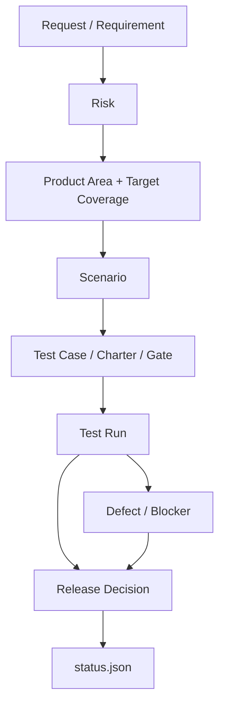

# Risk-Based QA Evidence Pack 模版規劃

> [!important] Status: Planning Only
> 本頁定義 Evidence Pack 的資訊架構、模板責任、風險分級、證據契約與實作順序。目前尚未建立 `Templates/QA/`、尚未將任何來源 repository 接入，也沒有在本輪執行測試。舊 PASS、既有 receipt 或只有 test definition 的資料都不是 current evidence。

## 決策摘要

採用一個核心原則：**先建立可做 release decision 的最小 Quality Decision Contract，再由它產生 Dashboard status；不要先要求所有專案填完九份文件。**

九種核心模板是可重用的 **template library**，不是每個 release 都要產生九個實體檔案。實際 Evidence Pack 由風險分級決定：

- **QA-Lite**：以合併式最小證據包完成低風險變更。
- **QA-Standard**：拆出風險、範圍、案例、執行與 release decision，適用一般功能與 release。
- **QA-High-Risk**：增加獨立 reviewer、專項測試、rollback、production validation 與正式風險接受。

Dashboard 的 `.test-dashboard/status.json` 是從 Evidence Pack 衍生的 machine-readable projection，不是另一份人工維護的 source of truth。

```mermaid
flowchart LR
    A["QA Test Request"] --> B["Quality Risk Assessment"]
    B --> C["Test Spec / Coverage Design"]
    C --> D["Scenario / Case / Automation Links"]
    D --> E["Append-only Test Run Record"]
    E --> F["Defect / Accepted Risk"]
    F --> G["Release Quality Summary"]
    G --> H["Generated status.json"]
    H --> I["Sanitized public Dashboard snapshot"]
```



## 真正要解決的問題

Evidence Pack 的目的不是證明「QA 有寫文件」，而是讓決策者在短時間內回答：

1. 這次要發布的是哪個 release、commit、environment 與 scope？
2. 哪些重要風險已經測過，測到什麼深度？
3. 哪些沒有測、無法測、測失敗或證據已過期？
4. 目前能不能發布？理由與 residual risk 是什麼？
5. 誰提出判斷、誰覆核、誰接受風險？判斷何時失效？
6. 每個結論能否追溯到當次 test run、case、defect、log 或 artifact？

> [!warning] 文件完整不等於證據可信
> 格式一致、同一 repository、CI 顯示綠色，都不能單獨證明 release Ready。證據仍可能過期、範圍不足、對錯 commit、來自 mock、缺少 artifact，或由未授權流程覆寫。

## 範圍與非目標

### 本規劃包含

- 九種核心模板的用途、欄位、owner、review 與完成條件。
- 條件式專項模板與啟用條件。
- QA-Lite／Standard／High-Risk 分級與最小證據門檻。
- 共用 metadata、ID、狀態語意與 traceability。
- current evidence、freshness、append-only chronology 與 override 規則。
- 公開／內部證據分層、redaction、撤回、更正與退役。
- Dashboard status 產生規則。
- Pilot、驗收指標、停損條件與實作順序。

### 本規劃不包含

- 這一輪直接建立全部 Markdown template。
- 直接執行測試或把舊 receipt 改稱 current proof。
- 自動從 pass rate、code coverage 或 defect count 推導 Ready。
- 讓公開 Dashboard 成為內部 release approval system。
- 把 private logs、測試資料、帳號、內網 URL 或敏感 defect 內容發布到 GitHub Pages。
- 替任何 repository 自動 commit、push、deploy 或修改外部系統。

## 已驗證的現況輸入

| 輸入 | 已有內容 | 對本規劃的影響 |
|---|---|---|
| [[Low-Tech Testing Dashboard 實做計畫]] | 五欄 Dashboard、Product/Data Status 分離、七個候選 repo、sanitized snapshot | Evidence Pack 必須提供可追溯且可消毒的 Dashboard input |
| 原始 Low-Tech Testing Dashboard 文章 | Product Area、Effort、Coverage 0–3、Quality、Comments；人類判斷與管理層溝通 | 保留五欄簡化思想，但不能把溝通標籤誤當完整 evidence model |
| `D:\Codex\Web3\TESTPLAN.md` | Purpose、Scope、Out of Scope、Risk、Inventory、Environment、Pass Criteria | 可作 Test Spec 素材；仍缺 request、decision owner、完整 entry/exit、run chronology 與 release sign-off |
| CEX `docs/test-cases.md` | ID、priority、requirement/scenario、precondition/data、actions、expected result、suite | 可作 Test Case 基線 |
| CEX `docs/traceability-matrix.md` | Requirement → Scenario → Case/Gate → Script → Evidence | 可作 Coverage Inventory／Traceability 基線 |
| CEX `evidence/TEMPLATE.md` | SHA、worktree、environment、exact command、exit code、artifact hash、limitation | 可作 automated Test Run Record 基線 |
| CEX `evidence/MANUAL_TEMPLATE.md` | Tester/reviewer、manual case result、cleanup、defect、release recommendation | 可作 manual Test Run Record 基線 |
| `Templates/bug-report.md` 與 [[Bug記錄流程]] | 基本 defect 描述、重現、RCA 與 SLA | 需補 release/SHA/environment/test data/evidence/status impact/verification/公開分級 |

目前 `Templates/QA/` 尚不存在。實作時應新增，而不是把 QA 模板散放在 `Templates/` 根目錄。

## 核心治理決策

### 1. Dashboard 是投影，不是第二套真相

- Human QA assessment 必須存在 Release Quality Summary／Release Decision Record。
- Test results 必須存在 append-only Test Run Record。
- Defects 與 accepted risks 必須有獨立 ID 和狀態。
- Exporter 只能讀取上述證據並產生 `status.json`。
- Dashboard 只讀 sanitized snapshot，不直接修改 evidence 或 status。

### 2. 九種模板是 library，不是固定九份文件

同一 release 可以合併模板，只要保留必要欄位與 traceability：

- QA-Lite 可以把 `00 + 01 + 02 + 03` 合併為一頁 Decision Brief。
- Scenario、Case、automation script 可以用 Coverage Inventory 連結，不必複製內容。
- Defect 不存在時，不需要產生空白的獨立 Defect Report；Release Summary 記錄 `none observed` 與未證明範圍。
- Dashboard 接入前，`08-status.json` 不需要存在。

### 3. Current evidence 必須有明確 subject

每個判斷至少綁定：

- repository identity；
- release/tag 或 named target；
- branch 與 full commit SHA；
- clean worktree，或明確列出 uncommitted candidate；
- environment；
- tested scope 與 excluded scope；
- test run ID 與執行時間；
- evidence availability；
- assessment expiry。

### 4. Fail、Blocked 與 override 必須 append-only

- 後來的 PASS 是新的 attempt，不能覆蓋之前的 Fail／Blocked。
- 修正、rerun、waiver、override 都新增事件並互相連結。
- Summary 可以顯示 latest disposition，但 chronology 必須可重建。
- 被 Superseded 的文件仍保留 supersedes／supersededBy 關係。

### 5. 公開與內部證據分層

| 層級 | 用途 | 可信度／資料規則 |
|---|---|---|
| Internal evidence | QA 執行、debug、release decision | 可包含受控 logs 與內部 defect；權限限制 |
| CI gate evidence | 證明指定 SHA 通過指定 workflow | 受保護 branch/workflow、run URL、artifact retention |
| Public portfolio snapshot | 對外展示 sanitized QA status | allowlist 欄位；不能含秘密、個資、內網與敏感缺陷 |
| Audit archive | 長期重建決策與 chronology | immutable/append-only、保存期限與可存取性 |

四層可共用核心 ID、schema 與 provenance，但不能假設是同一份實體檔案或同一證據強度。

Pilot 0 retention policy：JUnit、raw logs／screenshots／machine artifacts 自 `generatedAt` 起保留 90 calendar days；sanitized receipts、Release Decision Record、withdrawal／correction／superseded chronology 保留至 project retirement 後 1 年。Raw artifact 到期後仍保留 run ID、subject SHA、hash、原路徑、expiry 與 unavailable reason；政策到期不等於本輪可刪除，實際刪除仍需明確 scoped approval。

## 共用 Quality Decision Contract

所有模板共用下列 metadata。QA-Lite 可放在同一份文件 frontmatter；Standard／High-Risk 可由索引檔統一記錄。

| 欄位 | 必填 | 說明 |
|---|---:|---|
| `templateVersion` | 是 | 模板本身版本；與 Dashboard schema 分開 |
| `artifactType` | 是 | request、risk、spec、scenario、case、run、defect、release-summary |
| `artifactId` | 是 | 不重複且不可改名的 ID |
| `documentStatus` | 是 | draft、in-review、approved、superseded、cancelled |
| `project`／`repository` | 是 | 專案與 repository identity |
| `releaseTarget` | 是 | tag、version、milestone 或明確 named target |
| `branch`／`commitSha` | 執行後必填 | 判斷對應的完整 revision |
| `environment` | 執行後必填 | OS、runtime、browser/device、external dependency class |
| `riskTier` | 是 | QA-Lite、QA-Standard、QA-High-Risk |
| `owner` | 是 | 對文件與更新負責的人 |
| `reviewer` | Standard/High-Risk | 覆核人；同人兼任時需揭露 |
| `decisionOwner` | release decision 必填 | 接受／拒絕 residual risk 的人 |
| `createdAt`／`updatedAt` | 是 | ISO 8601，含時區 |
| `expiresAt` | release assessment 必填 | 超過後不得視為 current proof |
| `confidentiality` | 是 | internal、restricted、public-candidate、public |
| `supersedes`／`supersededBy` | 條件式 | 文件版本鏈 |
| `traceLinks` | 是 | Requirement、Risk、Scenario、Case、Run、Defect、Decision IDs |

### ID 命名

| 類型 | Prefix | 範例 |
|---|---|---|
| Test Request | `QAR-` | `QAR-2026-014` |
| Risk | `RISK-` | `RISK-AUTH-003` |
| Test Spec | `TSPEC-` | `TSPEC-V140` |
| Scenario | `SCN-` | `SCN-AUTH-007` |
| Test Case | `TC-`／`MTC-` | `TC-AUTH-021`、`MTC-REST-003` |
| Test Run | `RUN-` | `RUN-20260816-001` |
| Defect | `DEF-` | `DEF-AUTH-019` |
| Accepted Risk／Waiver | `WAIVER-` | `WAIVER-2026-004` |
| Release Decision | `RQD-` | `RQD-V140-001` |

ID 一旦被引用不得重用。標題可以修正，ID 不改。

## 狀態語意必須分開

### 文件狀態

`draft`、`in-review`、`approved`、`superseded`、`cancelled`

### Test execution status

| 狀態 | 定義 |
|---|---|
| Pass | 在指定 subject 與 environment 下，實際結果符合 expected result |
| Fail | 已執行，實際結果不符合 expected result |
| Blocked | 因外部條件無法完成；必須記錄 blocker、owner 與 next action |
| Skipped | 有意不執行；必須記錄原因與風險處置 |
| Incomplete | 執行開始但證據或步驟不完整，不能算 Pass |
| Not Run | 尚未執行；不能推論品質 |

### Product Test Status

`Ready`、`At Risk`、`Blocked`、`Unknown`。這是 human-owned release assessment，不是測試計數公式。

### Dashboard Data Status

`Fresh`、`Stale`、`Invalid`、`Not Configured`、`Unreachable`。這只描述資料健康，不描述產品品質。

### 原 Dashboard contract 必須修正的語意

原文章把 `Ship` 放在 Test Effort，會混合「活動狀態」與「release disposition」。正式 schema 應拆為：

- `effortLevel`：none、low、medium、high；
- `executionState`：not-started、in-progress、paused、blocked、complete；
- `releaseAssessment`：ready、at-risk、blocked、unknown。

`Ship` 不再是 effort 值。此變更必須在 Dashboard schema freeze 前與 [[Low-Tech Testing Dashboard 實做計畫]] 對齊。

## 風險分級

不用複雜加權分數製造假精準；用 Impact 與 Uncertainty 做一致判斷，並設 hard triggers。

### 判斷維度

| 維度 | Low | Medium | High |
|---|---|---|---|
| 使用者／商業衝擊 | 局部、容易恢復 | 主要流程受影響 | 無法使用、財務／信任重大損失 |
| 變更範圍 | 單一、隔離 | 跨 component | 跨系統、架構、migration |
| 技術不確定性 | 已知模式 | 新組合／部分未知 | 新技術、外部依賴、不可控狀態 |
| 可偵測性 | 立即明顯 | 需檢查才能發現 | 靜默錯誤、延遲資料損壞 |
| 可恢復性 | 可快速 rollback | 需人工處理 | 不可逆或高成本恢復 |

### 分級規則

- **QA-Lite**：所有維度 Low，且沒有 hard trigger。
- **QA-Standard**：任一維度 Medium，或有兩個以上 Low 風險互相依賴。
- **QA-High-Risk**：任一維度 High，或命中 hard trigger。

### High-Risk hard triggers

- Authentication、authorization、secret、personal data。
- Payment、資產、交易、計費或財務計算。
- Database schema、migration、批次改寫或不可逆資料處理。
- 安裝、upgrade、rollback、release infrastructure。
- 破壞性操作、權限升級或 production data mutation。
- Public API／contract breaking change。
- Security、privacy、legal／compliance requirement。
- 高流量、效能／可用性 SLO、外部服務依賴。
- 已知 S0／S1 defect 或先前發生過嚴重 incident 的區域。

Risk tier 在 Test Request 後由 QA owner 提議；Standard／High-Risk 需 reviewer 確認。Scope 或 residual risk 改變時重新分級。

## 各風險層級的最小 Evidence Pack

| Artifact | QA-Lite | QA-Standard | QA-High-Risk |
|---|---|---|---|
| Decision Brief（00+01+02 可合併） | 必填 | 可拆分 | 應拆分 |
| Test Request | Brief 內 | 必填 | 必填＋核准 |
| Risk Assessment | Brief 內 | 必填 | 必填＋獨立 reviewer |
| Test Spec | Brief 內 | 必填 | 必填＋專項策略 |
| Scenario／Coverage Inventory | 精簡 | 必填 | 必填＋traceability review |
| Detailed Test Case | 視重現性 | 風險／回歸案例必填 | 關鍵、負向、邊界必填 |
| Test Run Record | 每次執行必填 | 每次執行必填 | 每次執行必填＋review |
| Defect Report | 發現 defect 才建立 | 發現 defect 才建立 | 發現 defect 必填＋triage |
| Release Quality Summary | 必填 | 必填 | 必填＋decision owner sign-off |
| `status.json` | Dashboard repo 才產生 | Dashboard repo 才產生 | Dashboard repo 才產生＋publish review |
| 專項模板 | hard trigger 才啟用 | 依風險啟用 | 所有命中領域都啟用 |

> [!tip] QA-Lite 的四個 logical records
> 1. Decision Brief（內含 Coverage Inventory）；2. append-only Run Ledger；3. Defect／Risk Log；4. Release Decision Record。這四者可以是同一份短文件的不同 section，但不可以漏掉 subject、risk、coverage trace、actual result、defect／accepted-risk disposition、limitation 與 decision。

## 九種核心模板規格

### 00 — QA Test Request

**目的**：在開始規劃前，把「誰要求測什麼、為何現在測、最後要做什麼決策」說清楚。

**Owner**：Requester；**QA owner** 負責接受、退回或要求補資料。Standard／High-Risk 由 release／product owner 確認決策需求。

**必要欄位**：

- Request ID、requester、requested date、target decision date。
- Repository、release target、candidate SHA（若已有）。
- Change summary、business objective、affected users。
- Requested scope、explicit out of scope。
- Known risks、known defects、dependencies、assumptions。
- Target environments、platforms、data constraints。
- Acceptance／release question：這份測試要支持哪個決策？
- Available requirements、design、issue、PR、runbook links。
- Time／people／environment limitations。
- Public disclosure classification。

**完成條件**：QA 能判斷 risk tier、testability、所需環境與決策期限。資訊不足時狀態為 `needs-information`，不能直接開始並默認 scope。

**常見錯誤**：只有「幫我測一下」、沒有 release target；把所有功能都列入 scope；把 deadline 當作 Ready 標準。

### 01 — Quality Risk Assessment

**目的**：決定測試資源要投入哪裡、每個 Product Area 需要到哪個 coverage target。

**Owner**：QA owner；**Contributors**：developer、product／release owner、security／operations（適用時）。

**必要欄位**：

- Risk ID、affected Product Area、risk statement。
- Failure mode、cause／trigger、affected user or asset。
- Impact、likelihood／uncertainty、detectability、recoverability。
- Existing controls 與其 evidence。
- Target coverage level、test response、owner。
- Residual risk、acceptance owner、review date。
- Hard trigger 與所需 conditional templates。
- Assumption／unknown；Unknown 不可被填成 Low。

**完成條件**：每個 critical Product Area 有 target coverage、test response 與 owner；未處理風險有明確 disposition。

**常見錯誤**：所有區域都標 High；用 defect 數量替代風險；只評發生機率、不評不可逆後果；未測就寫 Low。

### 02 — Test Spec

**目的**：定義這次如何取得足以支持 decision 的 evidence；不是羅列所有可能測試。

**Owner**：QA owner；Standard／High-Risk 需 reviewer。

**必要欄位**：

- Purpose、decision to support、risk tier。
- Subject：release、SHA、environment、scope、out of scope。
- Product Areas 與 coverage target。
- Test types：Functional、Non-Functional、Change-related。
- Approach：automated、manual、exploratory、inspection、live validation。
- Entry criteria、suspension／resumption criteria、exit criteria。
- Environment、test data、external dependencies、observability。
- Roles、schedule／timebox、resource limitations。
- Evidence output、artifact path、retention、review method。
- Defect triage、retest、regression、waiver 與 escalation 規則。
- Known limitations：這份計畫不會證明什麼。

**完成條件**：每個高風險項目都有至少一個驗證方式與 evidence output；未覆蓋範圍明確列出。

**常見錯誤**：以 case 數量當 coverage；沒有 suspension criteria；未寫環境或 evidence；把 CI command 清單當完整 test strategy。

### 03 — Test Scenario

**目的**：用業務／使用者路徑描述要驗證的風險與結果，避免測試只剩技術函式名稱。

**Owner**：QA；product／domain reviewer 覆核 critical scenarios。

**必要欄位**：

- Scenario ID 與 `驗證…當…` 的 business-path title。
- Related requirement、risk、Product Area。
- Persona／actor、realistic start state、trigger。
- End-to-end flow boundary 與 expected business outcome。
- Happy／Positive 與 Sad／Negative coverage。
- Priority、target coverage level、applicable environment。
- Linked cases、automation、exploratory charter、latest run。
- Explicit exclusions／assumptions。

**完成條件**：核心流程與主要失敗路徑都有 scenario；scenario 不包含過度詳細的 click-by-click procedure。

**常見錯誤**：scenario 等同功能名稱；只寫 happy path；沒有 requirement/risk traceability；把 test step 塞進 scenario。

### 04 — Test Case

**目的**：提供可重現、可執行、可判定的細節。不是每個 exploratory idea 都必須變成 case。

**Owner**：QA／automation owner；critical case 需 review。

**必要欄位**：

- Case ID、title、module／Product Area、priority。
- Related requirement、risk、scenario。
- Test type 與 automation/manual classification。
- Preconditions、environment、concrete test data。
- Continuous reproducible steps／atomic actions。
- Observable expected result，避免「正常」或「應可使用」。
- Cleanup／rollback state。
- Actual result、execution status、run ID（執行後）。
- Defect、evidence、screenshot/log/artifact links。
- Parameter／boundary variants 與不適用理由。

**完成條件**：另一位 tester 能在同一 subject 下重現，並以客觀 observation 判定結果。

**常見錯誤**：Expected result 模糊；缺 test data；每一步彼此不連續；Pass 沒有 actual result；把 automation code 當唯一規格。

### 05 — Test Run Record

**目的**：保存每一次實際執行，而不是只保存最後一次通過。

**Owner**：執行者；Standard／High-Risk 由 reviewer 檢查 evidence accessibility。

**必要欄位**：

- Run ID、tester／runner、reviewer。
- Start/end time、duration、timezone。
- Full SHA、branch、worktree state。
- OS、runtime、tool/browser/device versions、external services。
- Exact command 或 manual procedure version。
- Test data identity／generation method，不公開 secrets。
- 每次 attempt 的 exit code、collected、Pass、Fail、Blocked、Skipped、warnings、retry reason。
- Case-level actual result；Fail／Blocked case IDs。
- Artifact path／URL、hash（可取得時）、retention／availability。
- Cleanup status、limitations、unexecuted coverage。
- Final run state；不得把部分 PASS 寫成整體 Passed。

**完成條件**：不看聊天記錄也能重建環境、命令、結果、限制與證據位置。

**Chronology rule**：Fail → fix → rerun Pass 要保留三個事件；不得只留下最後 PASS。

### 06 — Defect Report

**目的**：把觀察到的 failure 與 release risk 連結，而不只是留下重現步驟。

**Owner**：Reporter；developer/owner 負責處置；QA 負責 verification outcome。

**必要欄位**：

- Defect ID、title、status、severity、priority。
- Repository、release、SHA、environment、Product Area。
- Related requirement、risk、scenario、case、run。
- Preconditions、test data、reproduction steps。
- Expected result、actual result、reproducibility rate。
- User／business impact、release impact。
- Evidence links、artifact availability、confidentiality。
- Suspected／confirmed cause 必須區分。
- Owner、target fix、resolution、fixed SHA。
- Retest run、actual verification result、regression scope。
- Accepted／deferred 時的 decision owner、reason、expiry。

**完成條件**：能重現或明確說明不可重現原因；release impact 有 disposition；Fixed 不等於 Verified。

**與現有模板的關係**：實作時升級 `Templates/bug-report.md`，保留 RCA 與防止再發區，但新增上述 provenance、impact、verification 與 disclosure 欄位。

### 07 — Release Quality Summary

**目的**：把 evidence 轉成可辯護的 release recommendation；這是 human-owned decision input。

**Owner**：QA owner；**Decision owner** 接受或拒絕 residual risk。High-Risk 必須有獨立 reviewer。

**必要欄位**：

- Decision ID、release、full SHA、environment、assessment expiry。
- Scope、out of scope、risk tier、coverage target／actual。
- Run inventory 與 evidence availability。
- Pass、Fail、Blocked、Skipped、Incomplete 摘要，但不以數量直接決定 Ready。
- Open defects、accepted risks、waivers、external blockers。
- Product Area assessment：Effort、Coverage、Quality、Comment。
- Known limitations 與「本次 evidence 不證明什麼」。
- Recommendation：Ready／At Risk／Blocked／Unknown。
- 一句 decision rationale 與 required actions。
- QA owner、reviewer、decision owner、decision time、override／expiry。

**Ready 最低規則**：

- subject、scope、evidence 與 owner 完整；
- critical Product Areas 達事前 target coverage；
- 無未處置 release blocker；
- Blocked／Skipped／Incomplete 有明確 risk disposition；
- evidence 在 freshness SLA 內；
- 不存在 assessment 與 actual evidence 的未解衝突。

**禁止**：因 100% tests passed、coverage 高、defect 為 0 就自動標 Ready。

### 08 — `.test-dashboard/status.json`

**目的**：提供 Dashboard machine-readable projection。只對已接入 Dashboard 的 repository 產生。

**Owner**：Exporter／CI 產生；QA owner 對 assessment source 負責；publisher 對公開欄位負責。

**必須包含或可追溯**：

- Schema／contract version。
- Repository、release/tag、branch、full source SHA。
- Environment、tested scope、excluded scope。
- Product Test Status、decision rationale、decidedAt、expiresAt。
- QA owner、reviewer、override approver（適用時）。
- Run IDs、evidence links、open blocker／waiver IDs。
- Source-generated timestamp、snapshot sync timestamp。
- Data Status 計算所需欄位。
- Public disclosure classification。

**產生規則**：

- 來源缺漏、schema invalid、evidence expired 時不得輸出 current Ready。
- Exporter failure 不覆蓋 last-known-good；公開層保留舊 snapshot 但明顯標 Stale。
- 多 repo 發布採 atomic manifest，避免半新半舊組合。
- Public snapshot 只保留 allowlist 欄位，link 也必須逐一審查。
- `status.json` 不是 run ledger；不得在此覆寫 chronology。

## Coverage 等級的 Evidence 定義

Coverage 是測試深度的人工評估，不是 code coverage 百分比。

| Level | 意義 | 最低 evidence |
|---|---|---|
| 0 | Unknown／沒有可靠資訊 | 明確列為盲點，不推論 Pass |
| 1 | Sanity：主要功能與簡單資料可運作 | 基本 happy path、當次 run evidence |
| 1+ | 超過 sanity，但未觸及所有主要功能 | 已測／未測清單、部分 negative evidence |
| 2 | Common Cases：主要功能都被觸及，常見與關鍵流程已驗證 | Scenario coverage、常見 data/state、regression evidence |
| 2+ | 超過 common cases，增加資料、狀態或錯誤處理 | Boundary／negative／state transition evidence |
| 3 | Corner／High-Risk：strong data、複雜狀態、錯誤、壓力或重要 non-functional | 專項計畫、代表性極端條件、limitations 與 reviewer evidence |

每個 Product Area 的 target level 必須在測試前由 Risk Assessment 決定。次要區域 Level 1 可以是明確接受的風險；高風險區域不能因時程壓力自行降低 target。

## 條件式專項模板

條件式模板不是「有空再寫」，而是命中 trigger 才必須啟用。

| 模板 | 啟用條件 | 最低內容 |
|---|---|---|
| Test Data Sheet | 複雜、敏感、共享或需重現的資料 | dataset version、來源、生成、遮罩、reset、retention |
| Environment Readiness Checklist | 非單機、跨服務、設備／權限依賴 | components、versions、access、health checks、owner、expiry |
| Exploratory Charter | 未知多、需求不完整、需學習產品 | mission、risk、timebox、data、notes、findings、follow-up |
| Automation Spec | 新增重要自動化或 CI gate | purpose、boundary、oracle、fixtures、flakiness、retry、ownership |
| Performance／Reliability Plan | SLO、load、stress、capacity、recovery | workload model、baseline、threshold、monitoring、abort、environment |
| Security／Privacy Checklist | auth、secret、PII、權限、公開資料 | threat、data flow、abuse cases、access、logging、disclosure |
| Accessibility／Compatibility Matrix | UI、mobile、browser、assistive technology | supported matrix、WCAG target、keyboard、screen reader、contrast |
| Migration／Data Validation Plan | schema/data migration、bulk rewrite | before/after counts、invariants、reconciliation、rollback、sampling |
| UAT Script／Sign-off | 業務 acceptance 必要 | personas、business outcomes、data、actual result、signatory、limits |
| Production Validation／Rollback | deployment 會改 production behavior | precheck、smoke、monitoring、rollback trigger、owner、evidence |
| Post-release RCA | escaped severe defect／incident | timeline、impact、cause evidence、contributing factors、actions、verification |

## Traceability 最小圖



每個 Release Summary 至少要能從 decision 回到 run，再回到 scenario/risk。Traceability matrix 可以是獨立檔，也可以由 frontmatter／表格產生；不能只有文字聲稱「都有測」。

## Roles 與授權鏈

| Role | 主要責任 | 不得單獨完成的動作 |
|---|---|---|
| Requester | 提供目標、scope、deadline、acceptance question | 不得自行宣告 QA Ready |
| QA Owner | Risk、test design、evidence review、recommendation | 不得隱藏 missing evidence 或改寫 chronology |
| Test Executor | 執行並記錄 actual result | 不得將未執行 case 標 Pass |
| Repository Maintainer | 提供 build、環境、修正與 exporter | 不得以 code review 取代 QA evidence |
| Reviewer | 檢查 scope、traceability、evidence accessibility | High-Risk 不應只有形式簽名 |
| Decision Owner | 接受／拒絕 residual risk | 不得把 accepted risk 改寫成 QA 認定 Good |
| Publisher | sanitize、validate、atomic publish、撤回 | 不得修改 QA assessment 來讓畫面變綠 |

個人專案可能由同一人兼任多個角色；仍要在 evidence 中明確標示兼任，High-Risk 則要求至少一次獨立 review。

### Human override／Risk waiver

每次 override 或 risk acceptance 必須記錄：

- 原 assessment 與 override 後 decision；
- 原因、residual risk、affected scope；
- compensating controls；
- approver、decidedAt、expiresAt；
- required retest／follow-up；
- 關聯 defect、run、release；
- 公開層如何表達，不得把 override 隱藏成普通 Ready。

Expired waiver 自動回到需要 review 的狀態，不能永久沿用。

## Freshness、信任與防竄改

### Freshness

- Freshness SLA 由 repository config 設定，並依 release cadence 調整。
- Pilot 0 已核准：deterministic evidence 在 subject SHA 改變或執行後 30 calendar days 時失效，以先到者為準；live evidence 在執行後 7 calendar days 失效；release assessment 在 `decidedAt` 後 7 calendar days 失效。
- 新 run 不得回溯延長不同 SHA 或不同 scope 的舊 evidence。
- `updatedAt` 不是 run time；同時保留 `executedAt`、`decidedAt`、`generatedAt`、`syncedAt`。
- SHA、scope、environment 或 risk 有變化時，即使時間未超過 SLA，也要重新判定。
- Stale snapshot 可以顯示 last-known state，但不得以 current Ready 呈現。

### Provenance

- 使用 full SHA，不只短 SHA。
- 保留 workflow run URL／run ID、artifact path 與 retention。
- 可取得時保存 artifact hash；無法取得要寫明原因。
- 只有受保護 branch/workflow 或明確人工 review 能成為公開 publisher。
- Public manifest 記錄各 repo snapshot 的 source SHA 與 generated timestamp，整批原子發布。

### Threat model 最低問題

- 誰可以修改 assessment source？
- 誰可以改 exporter／workflow？
- 誰可以批准 override？
- 被攻擊或誤操作時如何撤回？
- 如何防止 fork、錯 branch、舊 artifact 或 local dirty result 冒充 release evidence？
- owner 失聯時由誰接手、降級或退役？

## Public disclosure 與資料分類

### Public allowlist

Pilot 0 核准只允許：

- public repository identity、branch、full SHA、named release target；
- `releaseAssessment`、Product Area、Coverage／target、sanitized test counts；
- `executedAt`／`decidedAt`／`expiresAt`／`generatedAt`／`syncedAt`；
- public issue／GitHub Actions run／仍可公開的 artifact links；
- sanitized rationale、limitations、evidence availability 與不含個資的角色名稱。

### 禁止公開

- credentials、tokens、cookies、session IDs。
- 測試帳號、真實個資、敏感 test data。
- local absolute paths、private repository path、內網 URL、private issue／artifact URL、電腦使用者名稱。
- account／order／fund／trade data、exploit detail、尚未修補 vulnerability、未消毒 defect detail／reproduction。
- 未取得同意的個人姓名、Email 或身份資訊。
- raw response／logs 中的 environment variables、headers、payloads 或其他未經 allowlist projection 的欄位。

### 發布前檢查

1. Schema validation。
2. Allowlist projection。
3. Secret／PII／internal URL scan。
4. Evidence link accessibility check。
5. Reviewer／publisher approval。
6. Atomic publish。
7. Post-publish smoke 與撤回能力確認。

## 錯誤、更正、撤回與退役

公開資料不能只有 publish，還要有 correction lifecycle：

- **Correction**：保留原 snapshot ID、錯誤說明、更正時間與 replacement ID。
- **Withdrawal**：敏感或誤導資料立即撤下，Dashboard 顯示 Withdrawn／Unknown，不靜默回綠。
- **Appeal**：repository owner 可提出 evidence-based correction request；由 publisher／QA review。
- **Owner unavailable**：William unavailable 時立即維持 Product Status `Unknown` 並停止 publish／override；超過 `1 working day` 後 Data Status=`Stale` 且 gate=`No-Go`。
- **Repository archived**：顯示 Retired／Archived 與最後有效 release，不再宣稱 current status。
- **Schema deprecated**：提供 migration window；過期 contract 顯示 Invalid，不默默猜欄位。

## 文件存放與 source of truth

### Obsidian：canonical template library

已建立：

```text
Templates/QA/
├─ 00-qa-test-request.md
├─ 01-quality-risk-assessment.md
├─ 02-test-spec.md
├─ 03-test-scenario.md
├─ 04-test-case.md
├─ 05-test-run-record.md
├─ 06-defect-report.md
├─ 07-release-quality-summary.md
├─ 08-dashboard-status-contract.md
└─ conditional/
   ├─ test-data-sheet.md
   ├─ environment-readiness.md
   ├─ exploratory-charter.md
   ├─ automation-spec.md
   ├─ performance-reliability-plan.md
   ├─ security-privacy-checklist.md
   ├─ accessibility-compatibility-matrix.md
   ├─ migration-data-validation-plan.md
   ├─ uat-signoff.md
   ├─ production-validation-rollback.md
   └─ post-release-rca.md
```

### Repository：執行時 evidence

```text
docs/quality/<release-or-feature>/
├─ quality-decision-brief.md
├─ risk-assessment.md
├─ test-spec.md
├─ coverage-inventory.md
├─ test-cases.md
├─ defect-log.md
└─ release-quality-summary.md

test-records/<run-id>/
├─ run-record.md
├─ machine-results.*
└─ artifacts/

.test-dashboard/
├─ config.json
└─ status.json
```

Obsidian template 是 authoring source；一旦套用到 release，執行文件必須複製進 repository 並跟 release version 一起 review。不要用 Obsidian transclusion 讓歷史 release 隨模板更新而改變。

## Template version 與 migration

- `templateVersion`、Evidence Contract version、Dashboard schema version 分開管理。
- Patch：文字、提示或不改欄位語意。
- Minor：新增 optional field，舊 evidence 仍有效。
- Major：刪除／改名 required field 或改變狀態語意，需要 migration。
- Template 更新不回寫歷史 evidence。
- Exporter 必須宣告支援的 contract versions；不支援時輸出 Invalid，不做猜測式轉換。
- 每次 major change 要有 migration guide、fixtures 與 validator tests。

## Dashboard 映射

| Dashboard 欄位 | Evidence source | 規則 |
|---|---|---|
| Product Area | Risk Assessment／Test Spec | 使用管理者理解的名稱；15–30 區域，扁平化 |
| Test Effort | Run ledger＋QA assessment | 拆成 effortLevel 與 executionState，不能由 test count 推導 |
| Coverage | Coverage Inventory＋QA assessment | 依 0–3 evidence anchors 判斷；不是 code coverage |
| Quality | Defect/Risk Log＋QA assessment | Good／Warning／Bad 必須有 rationale；Bad／Warning 連結 evidence |
| Comments | Release Summary | 顯示 blocker、defect、資源缺口、next action；公開前 sanitize |
| Product Status | Release Quality Summary | human-owned Ready／At Risk／Blocked／Unknown |
| Data Status | Exporter／sync validator | Fresh／Stale／Invalid／Not Configured／Unreachable |

Dashboard card 至少顯示 repository、release、SHA、environment、scope、最後驗證時間、evidence link、判斷角色與一句理由，並明示「狀態不是零缺陷或品質保證」。

## 唯一 Phase／Pilot 0：一個 repo、一次 release 的決策垂直切片

Pilot 0 是正式擴張前唯一允許的工作流。Subject 固定為 public `sanyoii/cex-market-data-quality-lab` `main@8fd5081254b5429e480ec20a56ef09bcc6f5ab9e`；使用者已於 2026-08-16 核准 named `releaseTarget`=`0.1.0 @ 8fd5081254b5429e480ec20a56ef09bcc6f5ab9e`，並指定 QA owner=`William`。Dirty worktree candidate、2026-08-15 local receipts 與舊 PASS 只能列為 historical／local evidence，未對 exact subject 重新取得 current evidence 前，`releaseAssessment` 必須是 `unknown`，不得標 current `ready`。

Pilot 0 未通過所有 gates 前：不接第二個 repository、不做 production deploy、不建正式 Dashboard UI、不展開完整九模板 library，也不把 fixture 或 mock 當 production proof。**本頁 G0–G6 是 canonical execution contract**；[[Low-Tech Testing Dashboard 實做計畫#唯一 Phase／Pilot 0：可執行 Gate 計畫]] 的 D0–D6 只補 workspace ownership 與 Dashboard delta mapping。兩頁若衝突，以本頁為準並停止執行，先修正文件而不猜測。

### Gate 共通執行契約

每個 gate 都要產生一份 receipt，至少記錄：gate ID、subject SHA、owner、inputs、exact commands／manual procedure、startedAt／endedAt、exit status、artifacts、limitations、reviewer、decision 與 stop reason。前一 gate 未簽核，不得開始下一 gate。Rollback 產物預設保留並標記 `abandoned`／`superseded`；任何刪除、覆寫或 active manifest 指標切換都需明確 scoped approval。

Pilot 0 total timebox=`1 working day`，定義為從第一個已核准 G1 action 的 `startedAt` 到 G6 decision 的 `endedAt`，必須落在同一個 Asia/Taipei 工作日且不超過 8 個 elapsed working hours。Clock 不得延長；超時即 No-Go。後續修正必須建立新的 attempt ID、重新記錄 subject／scope／clock，並保留原 attempt chronology。

Decision-latency baseline policy 已於 2026-08-16 核准：William 在 G0 使用現行 evidence flow 完成一次 read-only timed baseline，記錄回答「能不能發、為什麼、證據在哪」所需秒數、navigation steps、起訖時間與 limitation。Baseline receipt 必須在第一個 G1 `startedAt` 前完成，因此不計入 Pilot 的 8-hour clock；它只提供 before/after 比較，不以 `<=30 秒` 判定 G0 Pass/Fail。G5 仍須由陌生 external reader 執行正式 `<=30 秒` acceptance；receipt 尚未建立前 baseline=`Not Measured` 且 G0 Blocked。

Git ownership compatibility rule：若 runtime 回傳 `detected dubious ownership`，所有 G0–G6 Git read commands 必須使用該 command 專屬的 `git -c safe.directory='<normalized absolute repo path>' -C '<absolute repo path>' ...`；不得執行 `git config --global --add safe.directory`，也不得把 broad parent path 或 `*` 設為 safe。若 per-command override 仍失敗，改由正確 repository owner 執行並保存 receipt，否則 gate=`Blocked`。

G0 evidence root 已於 2026-08-16 核准為 `C:\Users\sanyo\OneDrive\文件\ChatGPT\TestDashboard\test-records\pilot-0\g0\`。此目錄只保存 append-only Pilot evidence：`pilot-charter.md`、`role-matrix.md`、`baseline-worksheet.md`、`decision-latency-receipt.md`、`execution-environment.md`、`decision-required-log.md`、`g0-receipt.md`；不是 template library、schema、Dashboard implementation 或 public artifact。七個 paths 任一已存在時不得覆寫；新 attempt 使用新 ID／目錄或明確 superseding record。實際建立仍需另行 scoped write authorization。

Pilot execution isolation policy 已於 2026-08-16 核准：G3 只能在另行建立的 clean detached worktree `D:\Codex\Web3\.worktrees\cex-market-data-quality-lab-pilot-8fd5081` 執行，且其 HEAD 必須固定為 `8fd5081254b5429e480ec20a56ef09bcc6f5ab9e`。目前含 20 項 dirty changes 的 `D:\Codex\Web3\cex-market-data-quality-lab` 只可作 historical／candidate reference，不得清理、覆寫或作 Pilot execution cwd。Clean worktree、dedicated runtime 與 artifact paths 的實際建立仍需另行 scoped write／setup 授權；建立前 G0 維持 Blocked。G3 執行前須保存 clean status，並 hash clean worktree 內的 `docs\manual-testing-lifecycle.md` 與 `evidence\MANUAL_TEMPLATE.md`；不得以 dirty working-copy 規格冒充 public-subject procedure。

### G0 read-only baseline refresh — 2026-08-16

> [!warning] Historical before-state snapshot
> 本節保存 G0 建立前的 freshly verified inventory，不是目前 gate disposition，也不授權 test run、artifact write、network live run、schema／template 建立、Git 或外部操作。Latest G0 disposition 以本節後方的 append-only reconciliation 與 G0 receipt 為準。

| Baseline item | Freshly verified evidence | G0 interpretation |
|---|---|---|
| Public subject | `sanyoii/cex-market-data-quality-lab`；local branch `main`；HEAD `8fd5081254b5429e480ec20a56ef09bcc6f5ab9e`；`origin/main...HEAD = 0/0`；HEAD 無 tag | Repository／branch／full SHA 可 freeze；release identity 尚未完成 |
| Release identity | `pyproject.toml` 宣告 project version `0.1.0`，HEAD 沒有 tag；使用者於 2026-08-16 明確確認 named target | 核准 `releaseTarget`=`0.1.0 @ 8fd5081254b5429e480ec20a56ef09bcc6f5ab9e`；這不建立 Git tag，也不改寫 repository |
| Worktree | `8fd5081-dirty`；17 個 tracked modified＋3 個 untracked，共 20 項；scoped diff 為 306 insertions／229 deletions | Dirty governance candidate 與 public HEAD 是不同 subject；不得混合判讀或清理 |
| Exact-subject execution isolation | 目前 clean detached worktree 尚不存在；使用者已核准規劃路徑 `D:\Codex\Web3\.worktrees\cex-market-data-quality-lab-pilot-8fd5081` 與 fixed HEAD policy | 建立 clean worktree、dedicated runtime 與 artifact paths 仍需另行授權；建立並驗證前 G0 Blocked，不得在 dirty checkout 執行 G3 |
| Exact-head public CI | GitHub Actions run [31823105148](https://github.com/sanyoii/cex-market-data-quality-lab/actions/runs/31823105148)，SHA=`8fd5081254b5429e480ec20a56ef09bcc6f5ab9e`；Python 3.12／3.14 deterministic jobs success；live job skipped | 可作 exact-HEAD deterministic CI evidence；不能證明 current-head live compatibility |
| CI artifact availability | `deterministic-py3.12`、`deterministic-py3.14` 均 `expired=false`，目前列示 expiry=`2026-11-12T17:14:56Z` | Artifact 現在可追，且列示 expiry 符合已核准的 90-day raw-artifact policy；實際 availability 仍以 provider state 為準 |
| Latest public live | 最近 public live run [31813561202](https://github.com/sanyoii/cex-market-data-quality-lab/actions/runs/31813561202) success，但 SHA=`9ce65e03b834c79c95bf2488c471be68cb7b1166` | Historical only；與 Pilot subject 不同，不能補足 current-head live gate |
| Local JUnit／receipts | `reports/` 有 6 份 2026-08-14／15 XML：deterministic 25／39／40 results，live 各 5 results，均為零 failure／error；40-result governance receipt 明示是基於 `8fd5081` 的 uncommitted candidate | Local/historical evidence 可用於 mapping 與 chronology，不是 exact public subject current PASS |
| Manual／exploratory | 10 個 `MTC-*` cases 與 exploratory charters 為 Designed；沒有 human execution result | Pilot 必測 `MTC-SAFE-001`、`MTC-EVID-001`；其餘 8 cases 與 exploratory charters 已核准 excluded，不能補成 PASS |
| Host／runtime／live boundary | Fresh read-only inventory：host=`Microsoft Windows NT 10.0.26200.0`；目前原 checkout `.venv`=`Python 3.14.2`；`pyproject.toml` 要求 Python `>=3.12` 並 pin runtime/test deps；未修改的 source/tests 指向 `data-api.binance.vision`、`data-stream.binance.vision` 與 `BTCUSDT` | Environment policy 可 freeze，但原 checkout venv 不是 dedicated Pilot runtime；clean-worktree venv 未建立前 G0 Blocked |
| Local execution preconditions | `.venv\Scripts\python.exe`、`tests\unit`、`tests\contract`、`tests\meta`、`tests\live`、`reports` 均存在；workflow 與 `pyproject.toml` 在 worktree 沒有 diff | Commands 可被重建，但本 refresh 未執行，存在不等於 PASS |
| Current assessment | Freshness SLA 與 scope 已核准；exact-head deterministic CI 仍在 30 天 window 內，但 required exact-subject live、`MTC-SAFE-001`、`MTC-EVID-001` 尚未執行 | Deterministic evidence 可標 Fresh；required evidence 不完整，`releaseAssessment=unknown`，不得由單一 Fresh source推成 Ready |

Candidate 判定：**仍有條件適合作唯一 Pilot 0，risk tier=`QA-High-Risk`**。理由是 public subject、deterministic CI、artifact 與 local mapping 素材可追；external live dependency 與 public trust boundary 命中 High-Risk，而 dirty candidate、current-head live 缺口及 required manual Not Run 仍未解除。第一個允許的後續動作仍是完成下列 Decision Required log，不是執行測試。

#### G0 latest disposition reconciliation — 2026-08-16

G0 append-only artifacts 已建立；clean detached worktree、dedicated Python `3.14.2` runtime、exact dependency versions、clean status 與兩份 manual-procedure hashes 已驗證。Current G0 receipt=`G0-RECEIPT-20260816-001`，SHA-256=`A89FE8F2D181331471D2D90D438CB13D33C2BD21C2A266E5E95FF799E06F9C9F`；latest disposition=`P0-G0=Pass`。這只解除 G0 environment/isolation blocker，不是 product Ready evidence；`releaseAssessment=unknown`，G3 tests/live/manual 仍未執行。

#### Single-operator portfolio authority model

本 Pilot 是 William 在個人系統上實作、供求職作品集展示的 single-operator project。所有 operational owner／authority roles 均由 `William` 擔任：QA owner、decision owner、publisher、override approver、repository maintainer、single writer 與 test executor。每份 receipt 必須揭露此兼任，不能以角色名稱數量暗示多人 separation of duties。

這個 authority model 只適用目前的 local demo／portfolio experiment，不是未來公司的 operating model。日後把系統帶入任職公司時必須建立新的 Pilot subject 並重跑 G0；William 可依職務負責 testing／QA，但 testing 以外的 decision、publisher、repository、security/privacy、accessibility 或其他 authority roles 必須按公司實際人員與權限重新分派。Demo receipts 可作設計 evidence，不得冒充公司的 approval、separation of duties 或 production evidence。

Reviewer、security/privacy reviewer、accessibility reviewer 與 G5 陌生讀者不是 Owner；需要獨立性時由外部唯讀參與者擔任，且不得由 William 的 self-review 冒充。若找不到外部 reviewer，對應 gate 維持 `Blocked`／`No-Go`。Single-operator 沒有 owner-unavailable backup；William unavailable 時立即維持 `unknown` 並停止 publish／override，超過 `1 working day` 後 Data Status=`Stale` 且 gate=`No-Go`。William 可以記錄 override proposal，但 self-approved override 不得單獨把 `unknown`、`blocked` 或 `at-risk` 升為 `ready`；升級必須有外部 reviewer receipt。

Local demo review amendment 已由 William 於 2026-08-16 核准：具名、read-only、與 writer 分離的 `independent-agent` review 可以解除 G1 並只放行 G2–G4 local demo implementation；receipt 必須明示 reviewer kind、agent identity、不是 Will、不是 human endorsement、reviewed artifact hashes、findings 與 outcome。此 amendment 不可用於公開發布、production／company reliance、G5 陌生讀者／accessibility acceptance、self-approved override 升為 Ready 或 G6 Go；上述情境仍要求非 William 的 human independent receipt。Will 原有 `Pending` chronology 保留，不得代填或冒充。

| G0 decision | Evidence-informed candidate／boundary | Status |
|---|---|---|
| `releaseTarget` | Named target=`0.1.0 @ 8fd5081254b5429e480ec20a56ef09bcc6f5ab9e`；HEAD 無 tag，本決策不宣稱 tag 存在 | Confirmed by user — 2026-08-16 |
| QA owner | `William` | Confirmed by user — 2026-08-16 |
| Decision owner／publisher／override approver／repository maintainer／single writer／test executor | `William`；所有 receipts 揭露 single-operator role overlap；publish 不等於 independent approval | Confirmed by user — 2026-08-16 |
| Owner-unavailable backup | Single-operator 無替代 Owner；逾核准 SLA 後降為 `unknown`、停止 publish／override | Confirmed operating boundary — 2026-08-16 |
| Execution workspace isolation | G3 使用 clean detached worktree `D:\Codex\Web3\.worktrees\cex-market-data-quality-lab-pilot-8fd5081`，固定 exact full SHA；原 dirty checkout 只讀保留 | Policy confirmed by user — 2026-08-16；creation/setup separately authorized |
| Pilot execution environment | Host=`Microsoft Windows NT 10.0.26200.0`；clean worktree 專用 `.venv`、Python=`3.14.2`；runtime/test deps=`httpx 0.28.1`、`websockets 17.0.1`、`pytest 9.1.1`、`pytest-asyncio 1.4.0`、`pytest-timeout 2.4.0`；live REST=`https://data-api.binance.vision`、WebSocket=`wss://data-stream.binance.vision`、test data=`BTCUSDT` public market data；禁止共用 dirty-checkout venv、credentials、account/order/trade/fund operations | Policy confirmed by user — 2026-08-16；dedicated venv setup separately authorized |
| Future company adoption | 目前是 William 的 local demo／portfolio experiment；帶入公司時以新 subject 重跑 G0，依實際組織重新指定 testing 以外 roles／authorities；demo receipt 不等於 company approval | Confirmed by user — 2026-08-16 |
| Reviewer／security/privacy reviewer／accessibility reviewer／陌生讀者 | G1 local demo 可由具名 `independent-agent` 唯讀 review，只放行 G2–G4；public／production／company reliance、G5、G6 與 Ready override 仍需非 William 的 human receipt。Will identity保留 Pending，不得代填 | Demo-only amendment confirmed by user — 2026-08-16；human receipt pending |
| Tested／excluded scope | Required：`tests\unit`、`tests\contract`、`tests\meta`、`tests\live`、`MTC-SAFE-001`、`MTC-EVID-001`。Excluded：帳戶／認證／下單／資金、load/performance、其餘 8 個 manual cases、exploratory charters、第二 repo、正式 UI、publication | Confirmed by user — 2026-08-16 |
| Freshness SLA | Deterministic：SHA 改變或 30 calendar days，以先到者為準；live：7 calendar days；release assessment：`decidedAt` 後 7 calendar days | Confirmed by user — 2026-08-16 |
| Evidence retention | JUnit／raw artifacts=`90 calendar days`；sanitized receipts、release decisions、withdrawal／superseded chronology=`project retirement + 1 year`；到期後保留 metadata/hash/unavailable reason，刪除另需 scoped approval | Confirmed by user — 2026-08-16 |
| Maintenance budget | 每次 release 的例行 evidence／status 更新 `<=30 分鐘` 且 `<=5` 個人工步驟；首次 Pilot 建置時間排除，但仍另行記錄 | Confirmed by user — 2026-08-16 |
| Unknown resolution／owner-unavailable SLA | Unknown event 必須在 `1 working day` 內取得 disposition；William unavailable 時立即維持 Unknown／停止 publish，超過 `1 working day` 後 Data Status=`Stale` 且 No-Go | Confirmed by user — 2026-08-16 |
| Live network authorization | 每次 network run 執行前需另行明確核准；只允許 public market-data endpoints，不得存取帳戶、認證、下單或資金功能；未取得該次核准時 G3=`Blocked` | Confirmed by user — 2026-08-16 |
| Public disclosure allowlist | Allow：repository、branch、full SHA、release target、assessment、coverage、test counts、timestamps、public Actions links、sanitized limitations。Deny：local absolute paths、raw response/log、secret、account/trade data、internal URL、computer username、unsanitized defect detail | Confirmed by user — 2026-08-16 |
| Risk tier | `QA-High-Risk`；trigger=`external live dependency`＋`public trust boundary` | Confirmed by user — 2026-08-16 |
| High-Risk independent reviewer | G1 local demo route允許與 writer 分離的具名 `independent-agent` review；不是 human endorsement，只能放行 G2–G4。對外採信、production/company、G5、G6 或 Ready override前仍必須取得非 William human reviewer receipt | Demo-only amendment confirmed by user — 2026-08-16；human receipt pending |
| Total timebox | `1 working day`：G1 `startedAt` 到 G6 `endedAt`，同一 Asia/Taipei 工作日且 `<=8` elapsed working hours；超時 No-Go，修正另開新 attempt | Confirmed by user — 2026-08-16 |
| Decision-latency baseline timing | William 已在 G0 以現行 evidence flow完成 read-only timed baseline；位於 G1 clock 前，只作比較、不套用 30 秒門檻；G5 才由陌生 external reader正式驗收 | Receipt recorded — 2026-08-16 |
| G0 evidence root／artifact boundary | `C:\Users\sanyo\OneDrive\文件\ChatGPT\TestDashboard\test-records\pilot-0\g0\`；固定七個 append-only Markdown artifacts；不是 templates/schema/UI，既有 path 不覆寫 | Seven artifacts recorded；latest `P0-G0=Pass` — 2026-08-16 |

#### Gate P0-G0 — Freeze subject、authority 與 budget

- **Objective**：把一次 release decision 的 subject、責任與量測門檻定死。
- **Inputs**：public `main@8fd5081254b5429e480ec20a56ef09bcc6f5ab9e`、live branch／HEAD／worktree／CI／artifact inventory、candidate disclosure boundary、核准的 clean detached worktree policy。
- **Actions**：記錄 repo/release/SHA/environment/tested scope/excluded scope；記錄 William 的 current demo role overlap、未來 company re-baseline boundary、外部 reviewer 與無 backup 時的 fail-closed 行為；核准 Freshness SLA、evidence retention、maintenance budget、Unknown resolution SLA、Pilot 0 total timebox=`1 working day` 的 same-day vertical slice，以及 clean worktree／dedicated runtime／public endpoint／test-data／artifact isolation；在第一個 G1 `startedAt` 前完成 William 的現況 decision-latency read-only baseline；原 dirty checkout 僅作 read-only inventory。
- **Deliverables**：在核准 G0 evidence root 內建立 `pilot-charter.md`、`role-matrix.md`、`baseline-worksheet.md`、`decision-latency-receipt.md`、`execution-environment.md`、`decision-required-log.md`、`g0-receipt.md`；`g0-receipt.md` 連結其餘六份，不複製第二套 truth。Clean worktree 與 runtime 建立後，把 exact HEAD／clean status／OS／Python／dependency／endpoint／test-data／manual-spec hashes 收入 `execution-environment.md` 與 `g0-receipt.md`。
- **Exact verification**：先設定 `$g0Root='C:\Users\sanyo\OneDrive\文件\ChatGPT\TestDashboard\test-records\pilot-0\g0'`，七個核准檔案必須全部 `Test-Path=True`，且每份具有 artifact ID、status、subject SHA、owner、createdAt／updatedAt、limitations 與 trace links；建立前任一路徑已存在即 fail closed，不得覆寫。設定 `$sourceRepo='D:\Codex\Web3\cex-market-data-quality-lab'` 與 `$sourceSafe='D:/Codex/Web3/cex-market-data-quality-lab'`，依序執行 `git -c safe.directory=$sourceSafe -C $sourceRepo rev-parse --abbrev-ref HEAD`、`git -c safe.directory=$sourceSafe -C $sourceRepo rev-parse HEAD`、`git -c safe.directory=$sourceSafe -C $sourceRepo status --short`、`git -c safe.directory=$sourceSafe -C $sourceRepo rev-list --left-right --count origin/main...HEAD`；不得修改 global safe.directory。William 逐欄自查 Charter 與輸出並保存 G0 draft receipt。另以現行 evidence flow 計時回答三個決策問題，receipt 記錄 start/end、elapsed seconds、navigation steps、answers、limitations，且 timestamp 必須早於 G1 `startedAt`。External reviewer 不作為 G0 Pass 前置條件，但必須在 G1 sign-off 重新檢查 Charter、Contract 與 threat model。
- **Acceptance criteria**：public HEAD 與 clean detached worktree HEAD 都必須等於指定 full SHA；G3 worktree 在首次執行前必須 clean，manual procedures 來自該 clean worktree且 hashes 已記錄；dedicated runtime 必須符合核准 OS／Python／dependency versions，live 只允許兩個核准 public endpoints 與 `BTCUSDT` public market data，且無 credential／account／order／trade／fund path；G0 decision-latency baseline receipt 已建立且早於 G1 clock，但不套用 30 秒門檻；subject／excluded scope／operational roles／reviewer slot／所有 SLA、budget 與 `1 working day` total timebox 都已核准。G0 可在 reviewer identity pending 時完成；G1 local demo 依核准 amendment 接受具名 independent-agent receipt，human receipt 仍是 public／production／company／G5／G6 硬 gate；其他任何缺值維持 Decision Required。
- **Stop／rollback**：HEAD drift、clean worktree 不存在或不乾淨、manual procedure 來自 dirty checkout、G0 path collision、trace 斷裂、來源不一致或 owner 未指定即停止；保留已建立的 G0 artifacts 並標 `abandoned`／`superseded`，不覆寫、不刪除、不建立模板或 status，也不清理原 dirty checkout。
- **Approval boundary**：read-only inspection 不需新授權；建立 worktree／runtime／artifact paths、任何 test run、repo write、network live run、Git 或外部操作均另行授權。
- **Responsible roles**：William 以 QA owner／repository maintainer／decision owner身分起草、提供 inventory、自查並核准 G0；外部 reviewer 在 G1 sign-off 唯讀重驗 Charter／Contract／threat model 並揭露獨立性。

#### Gate P0-G1 — Freeze Quality Decision Contract 與 threat model

- **Objective**：建立唯一 source-of-truth 與可驗證的授權鏈。
- **Inputs**：approved Pilot Charter、共用 metadata、四層 evidence policy。
- **Actions**：定義 author/reviewer/publisher/override/withdraw/retire 權限；確認 protected-source design、implementation gap 與後續 receipt gate；正式拆分 `effortLevel`、`executionState`、`releaseAssessment`；缺漏、過期、不合法或 Ready 但 critical area 未達 target coverage 的資料一律降為 `unknown`，禁止保留 current Ready；核准 wrong branch、wrong repository/fork、wrong full SHA、stale artifact、unauthorized override／publisher、expired waiver、critical coverage conflict 八個 negative case specifications、fixture paths 與 expected policy IDs。
- **Deliverables**：versioned Contract、authorization matrix、threat-model checklist、schema decision record、reviewed protected-source design／gap disclosure、negative fixture manifest 與 expected policy IDs。
- **Exact verification**：local demo route 由具名 independent-agent 逐欄檢查 Charter、Contract、authorization matrix、threat-model checklist、negative fixture manifest 與 protected-source design/gap，receipt 記錄 reviewer kind/identity、not-human limitation、reviewed file hashes、findings與outcome；manifest 必須為八個案例各指定 fixture path、expected non-zero 與唯一 expected policy ID：`SUBJECT_BRANCH_MISMATCH`、`SUBJECT_REPOSITORY_MISMATCH`、`SUBJECT_SHA_MISMATCH`、`EVIDENCE_STALE`、`AUTH_OVERRIDE_DENIED`、`AUTH_PUBLISHER_DENIED`、`WAIVER_EXPIRED`、`COVERAGE_TARGET_NOT_MET`。本 gate 只 freeze 規格，不要求尚未由 G2 建立的 validator／fixtures 存在或執行；implemented protected workflow/hash receipt 移至 G4，且必須在任何 public-candidate output 前完成。
- **Acceptance criteria**：local demo 具有合格 independent-agent Contract／threat-model receipt；不存在第二套手動 status；四層 evidence 的 audience、authority、retention 與 disclosure 均分開；八個 negative case 的 input、expected policy ID 與 fail-closed disposition 均已核准；錯 branch、repository/fork、full SHA、舊 artifact、dirty local result、未授權 override/publisher、expired waiver與critical coverage conflict都不可冒充 public subject。缺少 agent receipt 時 G1=`Blocked`；agent receipt只允許進 G2–G4，public／production／company reliance、G5、G6與Ready override仍因缺human receipt而Blocked。
- **Stop／rollback**：schema 或 authority 仍有衝突就退回 G0；保留 decision record，不建立 exporter。
- **Approval boundary**：schema freeze、role authority 與 public disclosure 必須由 decision owner 核准；本計畫不視為核准。
- **Responsible roles**：William 兼任 QA owner／repository maintainer／publisher／decision owner；local demo由與writer分離的具名 independent-agent驗證contract與threat model；self-review不算獨立簽核，agent review不算human endorsement。

#### Gate P0-G2 — 建立四個 logical records、validator 與故障 fixtures

- **Objective**：只做可支持 release decision 的最小 evidence bundle。
- **Inputs**：approved Contract、Pilot Charter、既有 CEX traceability/test-record 素材。
- **Actions**：建立 Decision Brief（內含 Coverage Inventory）、append-only Run Ledger、Defect／Risk Log、Release Decision Record；建立 Pass、Fail、Blocked、Unknown source fixtures，另建立 Invalid、Stale、missing／unsupported contract version policy fixtures、G1 核准的八個 threat negative fixtures與先Fail／Blocked後Pass chronology fixture。Unknown 是合法 human assessment source state，expected exit=`0`但不得顯示 current Ready；Invalid／Stale與contract-version negatives expected non-zero。Unreachable不是source `status.json` valid fixture，移至G4由fetch/sync failure產生。
- **Deliverables**：四個 logical records、schema／policy validator、fixtures、fixture manifest、authoring guide、G2 receipt；所有 fixture 都明示 `synthetic=true` 與「不是 current product evidence」。
- **Exact verification**：先 `Set-Location -LiteralPath 'C:\Users\sanyo\OneDrive\文件\ChatGPT\TestDashboard'`；`Test-Path -LiteralPath 'scripts\validate-status.mjs'`、`fixtures\pass-status.json`、`fixtures\unknown-status.json`、`fixtures\missing-contract-version-status.json`、`fixtures\unsupported-contract-version-status.json`、`fixtures\wrong-branch-status.json`、`fixtures\wrong-sha-status.json`、`tests\chronology.test.mjs` 與四個 `test-records\pilot-0\g2\` logical record paths必須為`True`。依序執行Pass／Fail／Blocked／Unknown四個source fixtures，expected exit=`0`，Unknown輸出`releaseAssessment=unknown`且不得含current Ready；missing／unsupported contractVersion各自expected non-zero並回傳`CONTRACT_VERSION_REQUIRED`／`CONTRACT_VERSION_UNSUPPORTED`；invalid-ready與stale-ready expected non-zero且輸出field/policy ID；再依G1 manifest執行八個threat negative fixtures，全部expected non-zero且依序回傳`SUBJECT_BRANCH_MISMATCH`、`SUBJECT_REPOSITORY_MISMATCH`、`SUBJECT_SHA_MISMATCH`、`EVIDENCE_STALE`、`AUTH_OVERRIDE_DENIED`、`AUTH_PUBLISHER_DENIED`、`WAIVER_EXPIRED`、`COVERAGE_TARGET_NOT_MET`。執行`node --test tests/status-policy.test.mjs tests/chronology.test.mjs`，expected exit=`0`；tests必須驗證Decision Brief含Coverage Inventory與target、Run Ledger保留immutable event IDs及Fail／Blocked chronology、Defect/Risk Log可trace run／subject／owner／disposition／expiry、Release Decision Record是唯一`releaseAssessment` authority，且chronology event count／immutable IDs不減少。
- **Acceptance criteria**：每個source fixture綁定release/SHA/environment/scope/evidence/owner/expiry；Unknown是valid exit=`0`且保持Unknown；Invalid／Stale、兩個contract-version negatives與八個threat negatives全部fail closed且無current Ready；Decision Brief含Coverage Inventory；Run Ledger append-only且後來PASS不覆蓋舊Fail／Blocked；每個Fail／Blocked、open defect、accepted risk與waiver都能從Defect/Risk Log trace到run、subject、owner、disposition／expiry；Release Decision Record是唯一assessment authority；fixture結果不得被引用為current product evidence。
- **Stop／rollback**：需要第五個常態人工 record、validator 會猜缺值或 fixture 無法重現即停止並修 contract；保留本 gate 產物並標 `abandoned`／`superseded`，不動既有 evidence；刪除或覆寫需明確 scoped approval。
- **Approval boundary**：建立檔案與 schema 實作需新的 write 授權；不得修改既有 CEX receipts。
- **Responsible roles**：William 兼任 QA owner／single writer／repository maintainer；外部 reviewer 唯讀驗證，不修改 artifacts。

#### Gate P0-G3 — 取得 exact-subject current evidence

- **Objective**：對唯一 subject 產生可重建的 current run，而不是沿用舊 PASS。
- **Inputs**：approved test scope、exact commands、環境與 test data、G2 records。
- **Actions**：只在已建立並驗證的 clean detached worktree 與 dedicated `.venv` 執行；在各自另行授權後執行 deterministic、required live network automation 與兩個 manual cases。先 hash clean worktree 內的 manual specification／template，再執行 `MTC-SAFE-001` 核對兩個核准 public endpoints、`BTCUSDT`、無 credential／account／order／trade／fund path，接著執行 automated commands，最後用 `MTC-EVID-001` 覆核所有 executed evidence。每次 attempt append-only 記錄 command／procedure hash、exit status、artifact、hash、warnings、blocker。
- **Deliverables**：current deterministic／live run receipts、兩份 JUnit、`MTC-SAFE-001`＋`MTC-EVID-001` manual receipt、updated Run Ledger、limitations。
- **Environment precheck**：在 `$pilotRoot` 內記錄 `[System.Environment]::OSVersion.VersionString`，expected=`Microsoft Windows NT 10.0.26200.0`；`& '.\.venv\Scripts\python.exe' --version` expected=`Python 3.14.2`，且 resolved executable path 必須位於 `$pilotRoot`。執行 `& '.\.venv\Scripts\python.exe' -m pip check` expected exit `0`；以 `pip show` 核對 `httpx=0.28.1`、`websockets=17.0.1`、`pytest=9.1.1`、`pytest-asyncio=1.4.0`、`pytest-timeout=2.4.0`，並記錄實際 build-tool versions。任一不符即 G3=`Blocked`，不得使用原 dirty checkout 的 `.venv` 代替。
- **Exact verification**：先設定 `$pilotRoot = 'D:\Codex\Web3\.worktrees\cex-market-data-quality-lab-pilot-8fd5081'` 並 `Set-Location -LiteralPath $pilotRoot`；`git rev-parse --abbrev-ref HEAD` 必須為 `HEAD`、`git rev-parse HEAD` 必須等於 `8fd5081254b5429e480ec20a56ef09bcc6f5ab9e`，首次執行前 `git status --short` 必須無輸出。`Test-Path -LiteralPath '.\.venv\Scripts\python.exe'`、`Test-Path -LiteralPath 'tests\unit'`、`Test-Path -LiteralPath 'tests\contract'`、`Test-Path -LiteralPath 'tests\meta'`、`Test-Path -LiteralPath 'tests\live'`、`Test-Path -LiteralPath 'docs\manual-testing-lifecycle.md'`、`Test-Path -LiteralPath 'evidence\MANUAL_TEMPLATE.md'`、`Test-Path -LiteralPath 'reports'` 必須為 `True`；把兩個 manual files 的 SHA-256 記入 receipt。先以 `$runId = 'RUN-{0}-{1}' -f (Get-Date).ToUniversalTime().ToString('yyyyMMddTHHmmssfffZ'), (git rev-parse --short=12 HEAD)` 產生並記錄唯一 Run ID，再設定 `$deterministicJUnit = Join-Path 'reports' "$runId-deterministic.xml"`、`$liveJUnit = Join-Path 'reports' "$runId-live.xml"`、`$manualReceipt = Join-Path 'evidence' "$runId-manual.md"`；任一路徑已存在即 fail closed，不得覆寫。依 clean `docs\manual-testing-lifecycle.md` 執行 `MTC-SAFE-001` 並把 actual／evidence 寫入 `$manualReceipt`；通過後使用 `& '.\.venv\Scripts\python.exe' -m pytest tests\unit tests\contract tests\meta -v --junitxml=$deterministicJUnit`，再於另行核准的 network session 使用 `& '.\.venv\Scripts\python.exe' -m pytest tests\live -v -m live --junitxml=$liveJUnit`。兩個 commands 都保存 exit code、JUnit hash 與 warnings；最後執行 `MTC-EVID-001`，逐一核對 run ID、SHA、scope、actual、hash、limitation 與 post-run `git status --short`，後者只能包含本 attempt 核准的 append-only artifact paths。任何 required live／manual evidence 未執行或缺失時 G3=`Blocked`，不得改寫成 excluded。reviewer 依 receipts 重建 subject 和結果。
- **Acceptance criteria**：deterministic、live、`MTC-SAFE-001`、`MTC-EVID-001` 都對應 exact SHA、scope、environment、actual status 與可取得 evidence；excluded scope 完整列示；local dirty 或歷史結果清楚分層且不參與 current Ready。
- **Stop／rollback**：clean worktree 在 run 前不乾淨、SHA/worktree 在 run 中漂移、runtime/dependency/endpoint/test-data 不符、dedicated venv 指向原 dirty checkout、post-run status 出現非核准路徑、manual-spec hash 不符、artifact 不可追或同一結果來源衝突即停止，assessment 降為 Unknown；保留失敗 receipts 與新 artifacts並標 `abandoned`／`superseded`，不覆寫 chronology，不清理原 dirty checkout；刪除或覆寫需明確 scoped approval。
- **Approval boundary**：任何會寫入 repo/artifact 的 test、live network、GUI、dependency 或 external service 均需明確授權。
- **Responsible roles**：William 兼任 test executor／QA owner／decision owner，但不得改寫 actual result；外部 reviewer 依 receipt 驗證。

#### Gate P0-G4 — Projection、sanitization 與 publication failure rehearsal

- **Objective**：證明 projection 可安全失敗並保留 last-known-good，而非完成正式 UI。
- **Inputs**：approved evidence、schema、public allowlist、redaction rules。
- **Actions**：產生 local sanitized snapshot 與一頁 minimal read-only pilot projection（只顯示決策三問、subject、四情境與 evidence links，非正式 Dashboard UI）；rehearse allowlist/redaction、Invalid/Stale downgrade、fetch/sync failure 產生 Data Status `Unreachable`、atomic manifest、last-known-good、correction、withdrawal、appeal、owner unavailable 與 retirement；建立 `test-records/pilot-0/g4/protected-source-receipt.md`，記錄 authoritative source、contract/schema/exporter/policy/workflow version與SHA-256、可修改角色、review outcome與limitations。
- **Deliverables**：local snapshots、minimal read-only pilot projection、atomic manifest、sanitization report、fetch/sync failure與 lifecycle rehearsal receipts、implemented protected-source receipt。
- **Exact verification**：先 `Set-Location -LiteralPath 'C:\Users\sanyo\OneDrive\文件\ChatGPT\TestDashboard'`；`Test-Path -LiteralPath 'scripts\sync-status.mjs'`、`Test-Path -LiteralPath 'fixtures\pass-status.json'`、`Test-Path -LiteralPath 'pilot-projection\index.html'`、`Test-Path -LiteralPath 'test-records\pilot-0\g4\protected-source-receipt.md'` 必須為 `True`。Protected-source receipt必須逐一列出authority source、`contractVersion`、schema/exporter/policy/workflow path與SHA-256、reviewer kind/identity、outcome與gap；任一缺漏即fail closed。執行 `node scripts/sync-status.mjs --source fixtures/pass-status.json --output data/repos/pilot.json --manifest data/repos/manifest.next.json` 後執行 `node scripts/validate-status.mjs data/repos/pilot.json`，expected exit `0`；再以 `fixtures/invalid-ready-status.json` 與 `fixtures/sensitive-status.json` 執行 sync，expected non-zero 且 active manifest hash 不變。執行 `node scripts/sync-status.mjs --source 'http://127.0.0.1:9/status.json' --output data/repos/pilot-unreachable.json --manifest data/repos/manifest.next.json`，expected non-zero並產生 `DATA_SOURCE_UNREACHABLE` receipt、保留 last-known-good、current Product Status 降為 Unknown；Correction／withdrawal fixture 保留原 snapshot ID、reason 與 replacement ID。
- **Acceptance criteria**：Council 四情境由 Pass／Fail／Blocked source snapshots加上 Unreachable fetch/sync failure 完整呈現；minimal projection 可被 G5 實際開啟與操作；protected-source receipt可由path/version/hash重建且local agent/security review outcome已記錄；local agent review不是human或public approval，因此所有輸出維持`internal-demo`，缺human receipt不得標`public-candidate`、不得public／production／company reliance；output零secret、PII、internal URL、local absolute path、private artifact或敏感defect detail；沒有half-published set；appeal有reviewer；owner unavailable超過核准SLA會降級；retired repo不宣稱current status。
- **Stop／rollback**：任一 sensitive value 外洩或 atomic switch 失敗立即停止；以新的 rollback event／manifest 將 last-known-good 標 active、subject 標 Withdrawn／Unknown，保留 failed candidate 為 `abandoned` 與 incident receipt；刪除、覆寫或指標切換需明確 scoped approval。
- **Approval boundary**：只允許 local rehearsal；公開、push、deploy、GitHub Pages、repo/account mutation 需另行授權。
- **Responsible roles**：William 兼任 publisher／QA owner／decision owner；外部 security/privacy reviewer 唯讀檢查 public artifact；無外部 receipt 不得把 self-approved override 升為 Ready。

#### Gate P0-G5 — Decision usability、accessibility 與量化驗收

- **Objective**：證明陌生讀者能快速、正確而非只看綠色做決策。
- **Inputs**：四情境 snapshots、local projection、metric baseline worksheet。
- **Actions**：在 375 px、768 px、desktop 與 320 CSS px／200% zoom 檢查；全程 keyboard 操作；驗 heading/table semantics、focus visibility、contrast，並以文字/icon/legend 辨識狀態；至少取得一種 screen reader／assistive technology receipt；測量 30 秒 decision test、trace success、correction/false-green、maintenance、adoption、Unknown resolution；至少完成 1 場陌生讀者 session，零樣本不得計 Pass。
- **Deliverables**：timed decision receipts、viewport/reflow screenshots、keyboard/focus與 screen-reader/AT receipt、semantics/contrast checklist、metric scorecard、reader answers。
- **Exact verification**：計時陌生 reviewer 回答「能不能發、為什麼、證據在哪」；逐一 trace 所有 pilot statuses；keyboard-only 走完主要流程；檢查 heading/table semantics、focus visibility、contrast、200% zoom與320 CSS px reflow；關閉/忽略顏色後重新辨識；至少以一種 screen reader或assistive technology取得操作 receipt；檢查固定文案「Ready 不是零缺陷或品質保證」及「Unreachable 是最近一次 snapshot 取得失敗，不是即時監控」。
- **Acceptance criteria**：至少 1 場陌生讀者 session；零樣本 No-Go。Decision time `<=30 秒`；evidence trace success `100%` 且每筆不超過兩次跳轉；pilot false-green `0`、correction `0`；四情境答案全部正確；375/768/desktop、320 CSS px/200% zoom reflow、keyboard、heading/table semantics、focus、contrast、非顏色辨識與至少一種 screen reader/AT 全部通過；無能力驗證 AT 則 Blocked，不得 Pass；maintenance `<=` G0 核准 budget；所有已執行 pilot decision sessions 以 Contract/projection 為入口；Unknown 在 G0 核准 SLA 內取得 disposition。
- **Stop／rollback**：任一門檻未達即停止擴張並回到造成缺口的 gate；不得以平均值掩蓋 false-green、敏感資料或 accessibility failure。
- **Approval boundary**：人工評測可 read-only；browser automation、screenshots 或工具安裝依實際環境另行授權。
- **Responsible roles**：外部 independent reviewer 執行 decision test，外部 accessibility reviewer驗收；William 以 QA owner記錄、以 decision owner判定 gate；若外部角色缺席則 Blocked。

#### Gate P0-G6 — Pilot close 與 expansion decision

- **Objective**：只在全部 evidence 完整時決定是否擴張。
- **Inputs**：G0–G5 receipts、open risks、metric scorecard。
- **Actions**：逐 gate 核對 acceptance；記錄 Pass/Fail/Blocked、residual risk、required correction；由 decision owner簽署 Go/No-Go。
- **Deliverables**：Pilot Close Report、signed expansion decision、remaining Decision Required list。
- **Exact verification**：所有 gate receipt 可存取且 subject 一致；沒有 open stop condition；metric scorecard 每項有 baseline、threshold、actual、outcome；scoped diff 不含未授權 repo/UI/template expansion。
- **Acceptance criteria**：只有 G0–G5 全部 Pass 且 open P0 issue 為 0 才能 Go；Blocked/waived gate 一律 No-Go。
- **Stop／rollback**：No-Go 時保留 Pilot artifacts 與 chronology，`releaseAssessment` 維持可辯護狀態，不接第二 repo。
- **Approval boundary**：擴張、正式 UI、完整九模板與第二 repo 都需要新的明確授權。
- **Responsible roles**：外部 reviewer整合 evidence；William 以 decision owner身分核准 Go/No-Go，並以 publisher身分執行後續動作；publisher 動作不得被當成另一份獨立核准。

### Pilot 0 指標、baseline 與 threshold

不得虛構 baseline 或 actual；首次量測前填 `Not Measured`。Threshold 未由業務責任人決定的項目維持 **Decision Required**，G0 未解決前不得執行或放行 Pilot。

| Metric | Baseline | Pilot threshold | Evidence | 未達標處置 |
|---|---|---|---|---|
| Decision latency | G0 由 William 以現行 evidence flow 完成 read-only timed baseline；receipt 前為 `Not Measured`，且量測位於 G1 clock 前 | G5 由陌生 external reader `<=30 秒` 回答三個決策問題；G0 baseline 不套門檻 | G0 stopwatch／navigation receipt＋G5 reader answers | G0 無 baseline receipt即不得開始G1；G5未達標則停止並簡化 contract/projection |
| Evidence trace success | `Not Measured` | `100%`；每筆 `<=2` 次跳轉 | trace sample ledger | 停止，修 trace/provenance |
| False-green count | `Not Measured` | `0` | 四情境 policy result | 立即停止，不得擴張 |
| Correction count | `Not Measured` | Pilot accepted snapshot `0` | correction ledger | 停止，修 schema/review；演練更正不計缺陷 |
| Maintenance time | `Not Measured` | 每次 release 例行更新 `<=30 分鐘` 且 `<=5` 個人工步驟；首次 Pilot 建置排除但另行記錄 | start/end time＋人工步驟；區分 one-time build 與 routine maintenance | 任一門檻超過即 No-Go，先簡化流程 |
| Adoption | `Not Measured` | 至少 `1` 場已完成陌生讀者 session，且 `100%` pilot decision sessions 以 Contract/projection 為入口；零樣本 No-Go | meeting/decision receipt | 停止，檢查使用價值 |
| Unknown resolution time | `Not Measured` | `<=1 working day` 取得 disposition；owner unavailable 同一 window | Unknown event ledger＋owner-availability receipt | 逾時即 Data Status=`Stale`、Product Status=`Unknown` 並 No-Go |

### Pilot 0 之後的 Phase 1

只有 G6 明確 Go 且另有寫入授權後，才依序：完成必要的其餘模板／conditional templates → 建正式 Dashboard UI → 選一個不同 test stack 的第二 repo 驗證 portability。第二 repo 通過前，不擴到其餘候選 repositories；任何 schema migration、publication、dependency、Git 或外部 mutation 仍各自需要授權。

## Definition of Done：模板規劃階段

- [x] 核心目的、非目標與 evidence boundary 已定義。
- [x] 九種核心模板的欄位與責任已列出。
- [x] 條件式模板與 trigger 已列出。
- [x] QA-Lite／Standard／High-Risk minimum pack 已定義。
- [x] Status、freshness、chronology、override 與 public disclosure 規則已定義。
- [x] Council 指出的授權、防竄改、量測、撤回、退役與 accessibility 已納入。
- [x] Pilot、acceptance、stop conditions 與 phase plan 已定義。
- [x] 九個核心模板已建立於 `Templates/QA/`。
- [ ] Pilot 尚未執行。
- [ ] Dashboard schema 尚未依本頁修正並 freeze。

## 實作前仍需明確指定的資料

這些不是本頁能替專案猜測的欄位：

| 項目 | 為何需要 |
|---|---|
| Pilot subject | Repository 固定為 `sanyoii/cex-market-data-quality-lab` public `main@8fd5081254b5429e480ec20a56ef09bcc6f5ab9e`；named `releaseTarget` 已核准為 `0.1.0 @ 8fd5081254b5429e480ec20a56ef09bcc6f5ab9e` |
| Operational owners／authorities | William 兼任 QA owner、decision owner、publisher、override approver、repository maintainer、single writer 與 test executor；所有 receipts 揭露 role overlap |
| Current demo／future company role boundary | 目前 authority model 只適用 local demo／portfolio experiment；未來公司採用必須以新 subject 重跑 G0，按實際人員重新分配 testing 以外 roles／authorities，不能沿用 demo approval |
| Pilot execution environment | 已核准 Windows NT `10.0.26200.0`、clean-worktree dedicated Python `3.14.2` venv、指定 pinned deps、兩個 Binance public endpoints 與 `BTCUSDT`；dedicated venv/setup 未建立前 G0 Blocked |
| External reviewers | Reviewer、security/privacy reviewer、accessibility reviewer 與陌生讀者不是 Owner；仍需指定唯讀外部參與者，否則相關 gate Blocked／No-Go |
| Freshness SLA | 已核准：deterministic=SHA 改變或 30 天先到者；live=7 天；release assessment=7 天 |
| QA-Lite maintenance budget | 已核准：每 release 例行更新 `<=30 分鐘`、`<=5` 個人工步驟；首次 Pilot 建置不計入門檻但必須記錄 |
| Unknown resolution SLA／owner-unavailable escalation window | 已核准：`1 working day`；owner unavailable 時立即 Unknown／停止 publish，逾時後 Stale＋No-Go |
| Current live evidence scope | 已核准為 required release gate；`tests\live` 每次 network run 仍需另行明確執行授權，且只允許 public market-data endpoints；缺少該次核准時 G3 Blocked |
| Public identity／SHA／evidence disclosure | 已核准 allowlist／denylist；公開仍需 D4 sanitization receipt 與另行 publication 授權 |
| Evidence retention | 已核准：JUnit／raw artifacts=90 天；sanitized receipts、release decisions、withdrawal／superseded chronology=退役後 1 年；刪除另需授權 |
| High-Risk independent reviewer | Risk tier 已核准為 `QA-High-Risk`。具名 independent-agent receipt只可放行G2–G4 local demo；不是Will或human endorsement。非William human reviewer receipt未取得前，public／production／company reliance、G5、G6與Ready override不得Pass；同一human可再參與G5 |

## 反向連結

- [[Low-Tech Testing Dashboard 實做計畫]]：本 Evidence Pack 提供 Dashboard status 的 source evidence 與 governance contract。
- [[Bug記錄流程]]：現有 bug 流程保留；實作 Defect Report 時需補 provenance、release impact、verification 與 disclosure。
