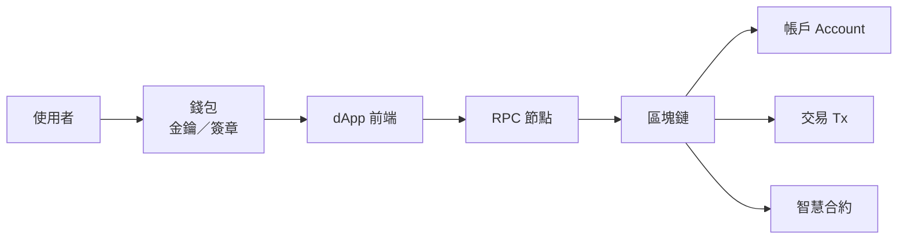

# Web3 基礎 · 第 1 章：你怎麼跟鏈互動

> **路線：** Web3 基礎 →（之後）Web3＋QA  
> **本章目標：** 能用自己的話說清「使用者→錢包→dApp→鏈」；分清錢包／帳戶／交易／合約。  
> **玩法：** 先讀本章 → 不懂隨時問 → 說「考我」再出章末題。  
> **建立：** 2026-09-12

## 一句結論

**Web3（以以太坊生態為例）= 把「所有權／身分／規則執行」放到公開、可驗證的鏈上狀態裡；你用錢包當身分與授權工具，透過 dApp 發請求，由網路執行後改寫鏈上狀態。**

ethereum.org 常把這波願景概括成 **read-write-own**（可讀、可寫、可擁有），核心特徵包含：較去中心化的所有權、**permissionless**（無需許可即可參與）、原生加密貨幣支付、較少依賴單一中介的信任假設（trust-minimized／incentive-based）。實務上仍有手續費、UX、安全責任等門檻。

## 心智圖：一次操作怎麼走

![[attachments/ch01-interaction-map.png]]

**口訣：** 狀態真相在鏈上；錢包負責身分與授權。

## 四個必分清的詞

| 詞 | 是什麼 | 常見誤會 |
|----|--------|----------|
| **帳戶 Account** | 一組金鑰對＋地址；地址可公開分享 | 「帳戶＝某個 App 的會員帳號」——鏈上帳戶跨 dApp 共用 |
| **錢包 Wallet** | 管理帳戶／金鑰、顯示餘額、連 dApp、**幫你簽章**的工具；可換錢包 App | 「錢包＝錢放在 App 裡」——資產在鏈上；錢包是遙控器 |
| **交易 Transaction** | 經簽章、廣播、被打包後改變鏈上狀態的請求（轉幣、呼叫合約、部署等）；通常要付 **gas**（以太坊上多用 ETH） | 「點了送出＝一定成功且可反悔」——可能失敗／卡住；確認後通常難逆轉 |
| **智慧合約 Smart Contract** | 部署在鏈上的程式＋資料；別人用交易去呼叫它 | 「合約＝法律合約 PDF」——這裡是鏈上可執行程式 |

來源：ethereum.org《Wallets》《What is Web3》《Intro to Ethereum》（技術入門）。

## 用超商類比（只為建立直覺）

- **鏈**＝公共帳簿＋自動販賣機規格（規則公開、大家看同一本）。  
- **合約**＝投幣後依程式吐貨的販賣機。  
- **錢包**＝你的印章／鑰匙串（證明「是你授權」）。  
- **dApp**＝店面橱窗（好看的 UI）；真正改帳簿的是鏈上執行。  
- **RPC**＝你跟帳簿之間的電話線（節點服務）。

類比有極限：真實系統還有 mempool、驗證者、L2 等——後面章節再拆。

## 本章你只要記住的 5 點

1. Web3 強調 **own**（所有權／可驗證狀態），不是只換成「有幣的網站」。  
2. **錢包 ≠ 帳戶**：錢包是工具；帳戶是金鑰與地址。  
3. 改鏈上狀態幾乎都要 **簽章＋交易＋gas**。  
4. **dApp 前端可以很中心化**；「去中心」多半指狀態與規則執行在鏈上。  
5. 交易確認後通常**難逆轉**——這也是後面學 QA 時「為何門檻高」的伏筆（先不展開測試）。

## 來源（本章）

| 來源 | URL | 可信度 |
|------|-----|--------|
| What is Web3? | https://ethereum.org/web3/ | 官方 |
| What is Ethereum? | https://ethereum.org/what-is-ethereum/ | 官方 |
| Wallets | https://ethereum.org/wallets/ | 官方 |
| Create an account | https://ethereum.org/guides/how-to-create-an-ethereum-account/ | 官方 |
| Intro to Ethereum（開發者） | https://ethereum.org/developers/docs/intro-to-ethereum/ | 官方 |

## 下一章預告

第 2 章：**帳戶、金鑰、助記詞與「簽章在授權什麼」**（仍屬 Web3 基礎，尚未進 QA）。

## 章末考題（你說「考我」再作答）

準備 4 題：選擇＋簡答；評 `正確／部分／錯`＋最小補課。現在先問不懂的地方即可。

---

## 延伸（本對話整理）

- 完整生命週期精修版與三張圖：[[Ch01-交易生命週期與精修版]]
- **提醒：** 本章用匯款當例子，主題仍是「互動與交易生命週期」，不是匯款專章。

- 名詞＋細拆完整整理：[[Ch01-完整筆記]]
