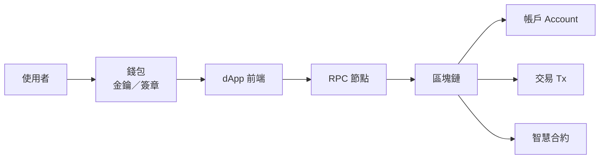

# Web3 基礎 · 第 1 章完整筆記：你怎麼跟鏈互動

> **路線：** Web3 基礎 →（之後）Web3＋QA  
> **本章主題：** 你怎麼跟鏈互動／一筆交易怎麼走完（**不是**匯款專章；Alice→Bob 只是實例）  
> **整理日期：** 2026-09-12  
> **相關圖文：** [[Ch01-你怎麼跟鏈互動]] · [[Ch01-交易生命週期與精修版]]

---

## 1. 一句結論

**Web3（先以以太坊生態為例）= 把「所有權／身分／規則執行」放到公開、可驗證的鏈上狀態裡；你用錢包當身分與授權工具，透過 dApp 發請求，由網路執行後改寫鏈上狀態。**

ethereum.org 常用 **read-write-own**（可讀、可寫、可擁有）形容 Web3 願景；常見特徵含較分散的所有權、**permissionless**、原生加密貨幣支付、較少依賴單一中介的信任假設。實務上仍有手續費、UX、自管金鑰風險等門檻。

**口訣：** 狀態真相在鏈上；錢包負責身分與授權。

---

## 2. 心智圖

### 2.1 你怎麼跟鏈互動
![[attachments/ch01-interaction-map.png]]

### 2.2 交易生命週期
![[attachments/ch01-tx-lifecycle.png]]

### 2.3 實例：Alice → Bob 10 USDC
![[attachments/ch01-alice-bob-example.png]]

---

## 3. 名詞說明

### 3.1 四個必分清的詞

| 詞 | 是什麼 | 常見誤會 |
|----|--------|----------|
| **帳戶 Account** | 一組金鑰對＋地址；地址可公開分享；跨 dApp 共用 | 「帳戶＝某個 App 會員帳號」 |
| **錢包 Wallet** | 管理帳戶／金鑰、顯示餘額、連 dApp、**幫你簽章**的工具；可換錢包 App | 「錢包＝錢放在 App 裡」——資產在鏈上；錢包是遙控器 |
| **交易 Transaction** | 經簽章、廣播、被打包後改變鏈上狀態的請求；通常要付 **gas** | 「點了送出＝一定成功且可反悔」 |
| **智慧合約 Smart Contract** | 部署在鏈上的程式＋資料；用交易去呼叫 | 「合約＝法律合約 PDF」 |

### 3.2 dApp（Decentralized Application）

**給你操作的應用程式**，多半是網站或 App 前端：畫面、按鈕、組出「你想做的事」（兌換、轉帳、鑄 NFT 等）。

- 名稱有 *decentralized*，**不代表前端伺服器一定去中心**。  
- 常見：UI 可以很中心化；真正改餘額／規則的是呼叫**鏈上合約**。  
- 類比：店面橱窗＋遙控面板；帳簿本體在鏈上。

### 3.3 RPC（Remote Procedure Call）／RPC 節點

**錢包／dApp 跟區塊鏈節點說話的通訊方式**（常講 RPC URL／RPC 節點）。

- 沒有 RPC，前端很難查餘額、也送不出交易。  
- 流程：dApp／錢包 → 經 RPC 問節點或送交易 → 節點連到網路。  
- 類比：**打給公共帳簿的電話線**。服務商（或自架節點）可換，帳本規則仍是鏈的共識。

**校正：**
- RPC **負責溝通（查詢／廣播）**，**不是**「負責把交易清算完成的那一方」。  
- 「兩人各有各自的 RPC」——**不一定**；常連同一服務商或預設節點。重點是最終對齊**同一條鏈的共識狀態**。

### 3.4 Mempool

交易廣播後、尚未進區塊前，待在 **mempool（公開等候區）**。  
這階段＝**尚未上鏈**。可能卡住（gas 太低）、被替換，或之後才被選走。

### 3.5 區塊／出塊

鏈不會自動把每筆簽名交易立刻寫進帳本；必須有人定期組出「下一頁帳本」（**區塊**），並把選定交易放進去。

- **出塊／提議：** 從 mempool **挑選**交易、執行、做成區塊並廣播。  
- 挑選常受 **gas／優先費、區塊容量** 等影響。  
- 類比：候機大廳（mempool）→ 下一班乘客名單（區塊）。

### 3.6 誰有資格出塊？（以太坊 PoS 入門）

- **驗證者（validator）**：依規則**質押 ETH**、跑驗證軟體、加入驗證者集合。  
- 一般轉帳使用者（Alice／Bob）**沒有**出塊資格。  
- **有資格 ≠ 每一秒都是你出塊**：協議輪流抽出當輪 **proposer**。  
- 與舊「挖礦」差：現在主網主流是權益證明，不是比顯卡算力。

### 3.7 出塊的人有什麼好處？

1. **協議獎勵**（參與共識的報酬）  
2. **Priority fee／小費**（使用者為加快被打包付出的部分）  
3. （進階）組塊順序相關的 **MEV** 等經濟誘因——入門知有即可  

作惡或嚴重失職可能被罰（slashing 等）。**好處＋風險**成對，激勵照規則維護帳本。

### 3.8 Gas

| 概念 | 意思 |
|------|------|
| **Gas** | 鏈上這次運算／存取消耗的「工作量單位」 |
| **Gas 費** | 為這些工作量付出的 **ETH**（與轉的 USDC 分開） |
| **Gas limit** | 最多允許消耗多少 gas |
| **Gas used** | 實際用掉多少（成交後較確定） |
| **Base fee** | 網路基礎費；EIP-1559 下**多半燒掉** |
| **Priority fee／tip** | 小費；給**當輪出塊相關角色** |
| **Max fee 等** | 你願意付的單價／總額上限類設定 |
| **gwei** | 很小的 ETH 單位，報價常用 |

**Gas ≠ 質押利息。**  
整筆 gas 不會變成「質押配息」；最多小費與當輪出塊者有關；質押收益是另一套共識獎勵機制。

**常見誤會：**
- Gas 付給 MetaMask／RPC？→ **否**（工具；費依鏈上規則分配）。  
- Gas 越高越安全？→ **否**（主要影響是否快被打包）。  
- Revert 就不用付？→ **常常仍要付**（已計算）。

### 3.9 超商類比（有極限）

| 概念 | 類比 |
|------|------|
| 鏈 | 公共帳簿＋自動販賣機規格 |
| 合約 | 投幣後依程式吐貨的販賣機 |
| 錢包 | 印章／鑰匙串 |
| dApp | 店面橱窗 |
| RPC | 打給帳簿的電話線 |

極限：還有 mempool、驗證者、L2 等，類比蓋不住。

---

## 4. 精修版匯款／轉帳流程（實例模型）

### 4.1 建議背誦版

Alice 在錢包填 **Bob 的帳戶地址** 與 **金額**（並看到預估 gas）→ 確認並**簽章** → 經 **RPC** 送出 → 進 **mempool** 排隊 → 被選進區塊後**依規則執行、當場改帳** → 其他節點**重跑／驗證**後對齊帳本 → 後面區塊不斷疊上，**確認加深**。

### 4.2 學習過程中的校正紀錄

| 易錯說法 | 更精準 |
|----------|--------|
| RPC 負責完成交易 | RPC 負責**送出／查詢** |
| 兩人必須各有一條專屬 RPC | 可共用或不同；對齊同一條鏈 |
| 全部節點 OK 後才扣款 | **進區塊並執行當下**就改狀態；之後是確認加深 |
| 確認加深＝寫入該筆的節點越來越多 | 確認加深≈**你的區塊上面又疊了多少新區塊** |
| Gas＝質押利息 | **否**（燒＋小費；質押獎勵另一套） |
| 轉帳費用（含糊） | 分開：**轉帳金額**＋**gas（ETH）** |
| Bob 錢包地址 | Bob 的**帳戶地址** |

### 4.3 確認加深再講一次

- **傳播／同步：** 節點追上並套用同一個區塊（對齊帳本）。  
- **確認加深：** 該區塊**上方**又不斷出新區塊 → 推翻越難。  
- 不是主定義成「簽名認可這筆的節點人數慢慢增加才入帳」。  
- （進階）尚有 finality／最終確定等更強鎖定概念；入門先抓「後面疊了幾塊」。

---

## 5. 同一筆交易三種結局

固定：Alice → Bob **10 USDC**。

| | **成功** | **Pending 卡關** | **Revert** |
|--|----------|------------------|------------|
| 卡在哪 | 進區塊且執行成功 | 多半仍在 mempool | 常有進區塊執行，但條件不過 |
| Alice USDC | −10 | 通常還沒扣 | 通常沒轉出 |
| Gas（ETH） | 有付 | 視顯示／是否仍佔用中 | **常仍要付** |
| Bob | ＋10 | 沒到 | 沒到 |
| 畫面 | Success／Confirmed | Pending／轉圈 | Failed／Reverted |
| 直覺 | 改帳完成 | 還在排隊 | 處理了但駁回 |

**有 tx hash ≠ 一定成功。**

### 5.1 Revert 收費冤不冤？

- **鏈的規則：** 已計算就可能收費；不管「錯是不是你的錯」。  
- **體感公平：** 若錯在 dApp／前端／錯誤提示（非使用者過失），使用者**很冤**——責任在產品要防（模擬執行、參數檢查、清楚錯誤）。  
- 鏈收費≠道德判決；**產品品質**決定冤不冤的體驗。

---

## 6. 本章帶走的 5 點

1. Web3 強調 **own**，不是「網站加上幣」而已。  
2. **錢包 ≠ 帳戶**。  
3. 改狀態 ≈ **簽章＋交易＋gas**。  
4. 前端可以很中心化；狀態／規則常在鏈上。  
5. 難逆轉、Revert 可能仍收費 → 之後學 Web3＋QA 的伏筆。

---

## 7. 來源（本章）

| 來源 | URL | 可信度 |
|------|-----|--------|
| What is Web3? | https://ethereum.org/web3/ | 官方 |
| What is Ethereum? | https://ethereum.org/what-is-ethereum/ | 官方 |
| Wallets | https://ethereum.org/wallets/ | 官方 |
| Create an account | https://ethereum.org/guides/how-to-create-an-ethereum-account/ | 官方 |
| Intro to Ethereum | https://ethereum.org/developers/docs/intro-to-ethereum/ | 官方 |

（Gas／EIP-1559、驗證者等細節以 ethereum.org 開發者文件與共識說明為準；教學有簡化。）

---

## 8. 「顯示成功但對方說沒到」還有哪些可能？

除了網路塞車（其實還在 Pending）之外，常見還有：

| 類型 | 意思 | Alice→Bob 直覺 |
|------|------|----------------|
| **成功語意太早** | UI 把「已廣播／剛進塊」顯示成綠色成功 | Alice 以為到了；確認其實還不夠 |
| **看錯鏈／網路** | 錢在 A 鏈，Bob 在看 B 鏈 | 同地址格式也可能餘額不共通 |
| **看錯代幣／沒顯示** | 幣已到，錢包沒列出該代幣合約 | 要加正確 token 或看瀏覽器 |
| **地址／備註錯誤** | 多貼字、或上所需要 memo 卻沒填 | 鏈上可能「成功」但 Bob 本人沒拿到 |
| **假成功／樂觀 UI** | 前端先顯示成功，鏈上其實 Fail | 以瀏覽器 status 為準 |
| **RPC／索引延遲** | 鏈上已成功，讀取端慢 | 稍等、換節點、用瀏覽器核對 |
| **進了合約／託管內部** | 不在 Bob 主畫面那一列餘額 | 進階情況，知有即可 |
| **詐騙假介面** | 假成功動畫 | 務必核對官方瀏覽器 tx hash |

### 看錯鏈 vs 看錯幣（Bob 怎麼辦）

| 狀況 | Bob 怎樣才看得到 |
|------|------------------|
| 看錯鏈 | 切到 **Alice 實際轉成功的那一條網路**（並用能控制該地址的錢包）。不是「隨便換一個錢包 App」就好。 |
| 看錯／沒顯示幣 | 鏈對了之後，再 **加入正確代幣合約**（或用區塊瀏覽器看 token 餘額）。 |

排查三步：① 複製 **tx hash** ② 在對應鏈的區塊瀏覽器看 status／鏈／代幣／收款地址 ③ 請 Bob 在**同一條鏈**查自己地址。

**一句話：** 畫面成功 ≠ 對方在他看的地方見到同一筆成功到帳。

---

## 9. 什麼是區塊瀏覽器？

**區塊瀏覽器（block explorer）**＝查鏈上公開帳本的網站／App。

可查：tx 成功或失敗、哪條鏈、哪個區塊、地址進出、代幣與 gas 等。  
以太坊常用例：Etherscan；其他鏈／L2 各有對應瀏覽器——必須對**同一條鏈**。

**一句話：** 區塊瀏覽器＝鏈的公開查帳頁；用 tx hash 或地址核對，比只信錢包綠勾可靠。

---

## 10. 第 1 章小考（題目）

> 先作答再看解答。評分：正確／部分／錯。

**Q1（辨識）** RPC 最主要的角色是？  
A. 負責最終清算、決定 Alice 錢有沒有到 Bob  
B. 讓錢包／dApp 查詢與廣播交易的通訊窗口  
C. 質押 ETH 後專門出塊的人  

**Q2（自行解釋）** 用自己的話寫「確認加深」是什麼。它是不是「寫入這筆交易的節點越來越多」？

**Q3（應用）** Alice 錢包顯示成功，Bob 說沒到。除了塞車／Pending，請再舉 **兩個** 可能原因，並各寫 Bob 或 Alice 下一步該查什麼。

---

## 11. 第 1 章小考（參考答）

> [!success]- 展開前請先作答
> **Q1：B。** A 是鏈上執行＋共識；C 是驗證者／出塊角色。  
> **Q2：** 確認加深≈包含該交易的區塊**上面又疊了更多新區塊**，推翻更難。主定義**不是**「寫入該筆的節點人數越來越多」。傳播／同步對齊帳本是另一層。  
> **Q3 示例（任一合理即可）：** 看錯鏈→對 tx hash 確認鏈並切同一網路；看錯／未顯示代幣→加對合約或瀏覽器查 token；UI 過早顯示成功→看瀏覽器 status／確認數；地址錯→核對收款地址；RPC 延遲→稍等或換節點／瀏覽器。  

## 12. 下一步

- [ ] 第 1 章小考（辨識／自行解釋／應用）  
- [ ] 第 2 章：帳戶、金鑰、助記詞與「簽章在授權什麼」
