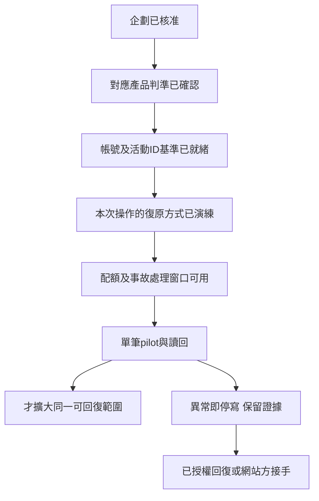

# 04-復原程序與進場檢查表

文件版本：test-docs-v1.0｜依據：已核准企劃v0.2｜2026-09-17

> 本文件已編製，不代表產品測試通過。實際結果僅寫入原案件case.json並連到Run證據。

## 進場關卡

| Gate | 檢查／證據 | 目前狀態 | 不通過時 |
| --- | --- | --- | --- |
| G-01 | 企劃v0.2與使用者「企劃通過」 | 已核准 | 不需重問同一企劃授權 |
| G-02 | 本次TC的有效版本與已確認oracle | 未完成 | 不判產品Pass/Fail |
| G-03 | 本機收信、QA帳號及實際活動ID | 未完成 | 不提交或猜測活動碼 |
| G-04 | 設定基準、回復前後對照、實際耗時 | 未演練 | 不做依賴該回復的操作 |
| G-05 | 45人時規劃上限、配額及已消耗核對 | 尚無Run；實際投入未知 | 不默默擴額；同問題最多有依據重試一次 |
| G-06 | 網站方事故聯絡人與處理窗口 | Unknown | 不做可能影響共享服務的故障/高影響測試 |
| G-07 | 證據位置、安全投影、無真實觀眾 | 未核對 | 不顯示或上傳內容 |

只讀文件盤點不需要先製造測試帳號；其餘僅要求該操作真正依賴的門檻。未知或未演練不能寫成「可recover」。

## REC-01｜我們設備的權限、網路與視窗

- 前提：獨立設定檔；記錄原網站相機權限、縮放、網路調節、顯示設定與目前活動ID。
- 回復：停止測試輸入 → 解除僅本機的網路限制 → 恢復原權限/縮放/方向 → 重開同一自有活動頁 → 核對內容與預覽。不清除他人的瀏覽資料。
- 驗證：記回復前後值、連線狀態、活動ID及可以再次操作的畫面。網路恢復不表示後端寫入復原。
- 停止：一次回復未成功或結果不明，保留證據；不反覆重送。瀏覽器runtime目前未證明可用，不冒充已完成。

## REC-02｜自有帳號的登入與找回

- 前提：可控信箱、已核對帳號代稱和憑證位置、實際可用的產品找回入口。
- 回復：登出錯誤工作階段 → 從可信入口正常登入 → 如確需找回，僅對自有帳號依已確認流程操作一次 → 在新分頁核對身分與自有活動。
- 驗證：信箱控制權、登入者、活動擁有者相符；不要把切換QA-B當QA-A資料已恢復。
- 停止：找回功能未確認、收不到信或帳號鎖住即停，交網站方窗口；不先測改email、失效信箱或故意鎖帳號。

## REC-03｜自有活動設定與測試舞台

- 前提：真正活動ID及擁有者已讀回；無客戶現場投影；保存標題、角色池、背景素材、比例及畫面模式的原值。只保存可見欄位，不假報完整後端備份。
- 演練：挑一個已確定可逆的測試欄位 → 記原值 → 改TEST值 → 讀回 → 改回原值 → 重整後台、來賓及舞台核對ID和畫面。
- 回復：停止新控制 → 確認目標ID仍正確 → 一次只改回一個已記錄欄位 → 讀回 → 恢復原舞台模式。不可盲目重套全部設定。
- 驗證：基準欄位逐一一致、QR歸屬正確、舞台可用、另一活動未受影響；最後一項僅能由已授權可見範圍證明。
- 限制：標題改回只證明標題可回復，不涵蓋自拍、留言、刪除或跨帳號控制。

## REC-04｜自建內容提交、撤回及資料重建

- 前提：回復操作已確認存在且限自有資料；保存素材與訊息識別。對撤回/移除的範圍另有明確授權；沒有時只能保留準備，不先送出。
- 提交結果不明：停止再送 → 在自有後台/舞台核對是否已有這筆 → 若存在，記成功但回覆異常；若不能證明不存在，不重送。
- 回復：若已核准且已演練的撤回/移除適用，僅對該筆執行一次；讀回隊列、畫面與對照活動。若只能重建活動，必須先取得允許，記新ID，不能宣稱原時間、隊列或資料已還原。
- 驗證：記原提交ID或可辨識字串、處理後狀態、未波及資料及剩餘配額。UI不見不是後端永久刪除證據。
- 停止：原資料無法還原、操作沒有授權或產品不提供移除時，不以「7天後會刪除」當已完成清理，不繼續增加測試內容。

## REC-05｜高影響操作或正式服務異常

- 目前不具備自主還原正式服務的證據。容量造資料、清除、時間快轉、變造權限與負載專項暫緩。
- 處置：停所有寫入及自動重試 → 保存最後正常時間、動作、匿名帳號/活動ID、版本、錯誤與已知影響 → 只做不擴大影響的觀察 → 由指定窗口聯絡網站方。
- 網站方須確認：受影響範圍、可用備份、還原點/粒度、期間新增資料處理、操作者與窗口。不得擅自回滾整個資料庫。
- 回復後：我們核對自有三端與基準；網站方確認共享服務/他人資料。原因及影響不明就不續測。
- RTO/RPO未知，不承諾固定恢復時間或零資料損失；本輪沒有故意破壞環境作演練。

## 每次復原演練的記錄

在案件內保存「REC-ID、對應TC、版本、操作者、時間、基準檔、目標ID、實際步驟、原值/變更/回復值、實際耗時、結果、未回復項、證據hash、續測判定與確認人」。這是待填格式，現在沒有演練成果。若為產品TC的一部分，回復結果跟同次Run的actual/reason及artifact連結；不把操作紀錄另外維護成第二份產品狀態。

## 反向連結

- [[一人軟體測試公司/_index]]
- [[一人軟體測試公司/PartyPiuPiu — 委託測試企劃]]
- [[一人軟體測試公司/PartyPiuPiu — 00-測試文件入口]]
